# Aweyuki Recovery

English | [简体中文](README.zh-CN.md) | [Tiếng Việt](README.vi.md)

Aweyuki Recovery is an Android recovery written in Rust, from scratch.

<p align="center">
  
  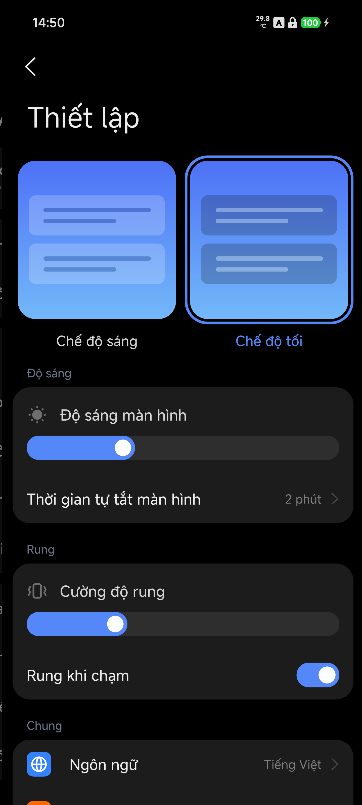
  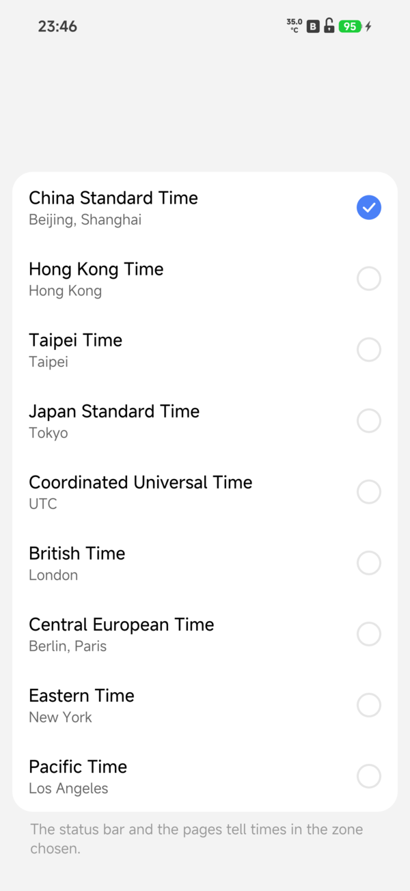
</p>

## Features

### Dual boot

<p align="center">
  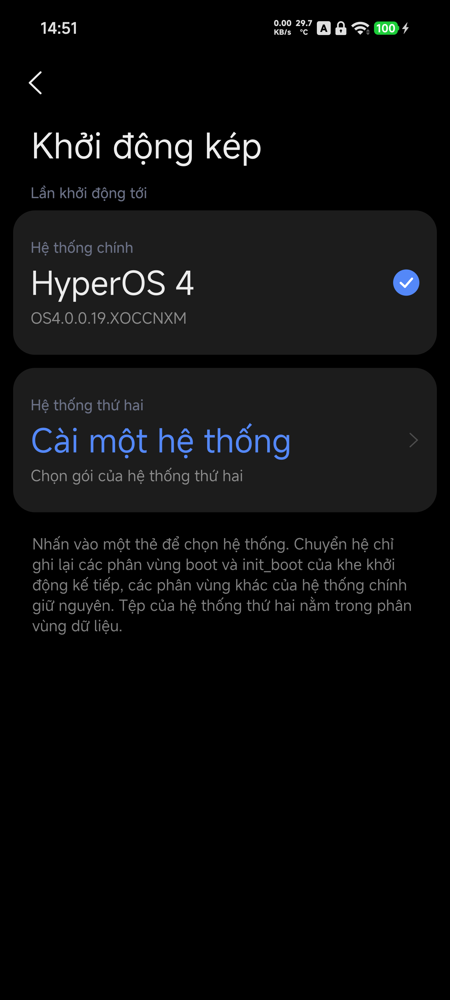
</p>

Run a second system alongside the installed ROM (HyperOS or custom ROM) with atomic `/metadata`-backed switching that rewrites only `boot` and `init_boot`. How a second system is packaged and started is in [How dual boot works](#how-dual-boot-works).

### Decryption & Recovery PIN Lock

<p align="center">
  
</p>

Decrypt `/data` using the system's screen-lock PIN, pattern, or password, and optionally protect recovery access itself with a Recovery PIN Lock.

### Installing, OTA Payload Inspector & Batch Flash

<p align="center">
  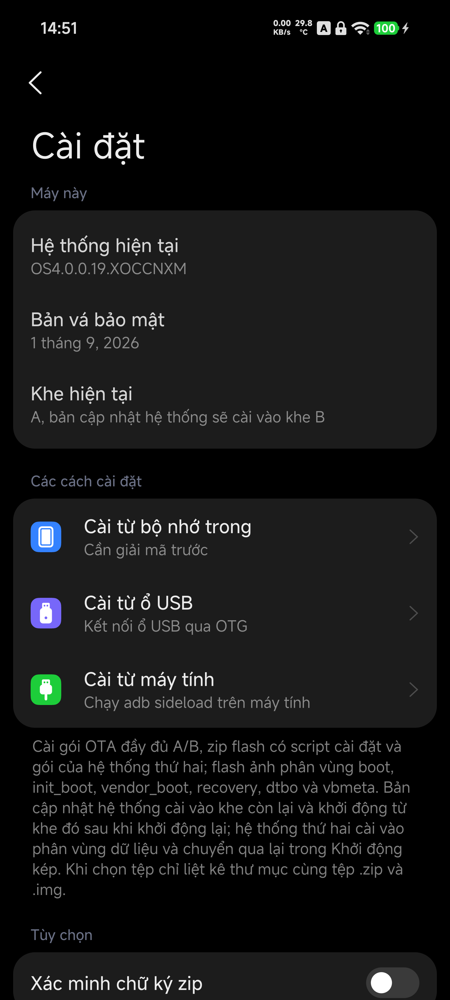
  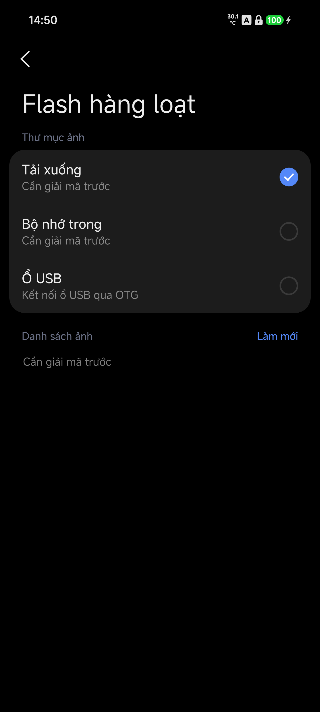
</p>

- **Install sources & tools**: Flash zips, `.img`, `.efi`, and dual-boot packages from Internal Storage, USB OTG, or ADB Sideload with optional zip signature verification. Install scripts get `7za`, `zstd`, streaming `unzip -p`, `avbctl`, and `resetprop`.
- **OTA Payload Inspector & ARB Check**: Inspect `payload.bin` and OTA `.zip` manifests, verify Anti-Rollback (ARB) security patch/timestamp levels, and extract partitions (`REPLACE`, `REPLACE_ZSTD`, `ZERO`, `DISCARD`).
- **Batch Flash & EFISP**: Queue and flash multiple `.img`/`.efi` files with partition geometry validation, including direct non-slotted ARM64 `.efi` flashing to `efisp`.

### Online updates & Wi-Fi

<p align="center">
  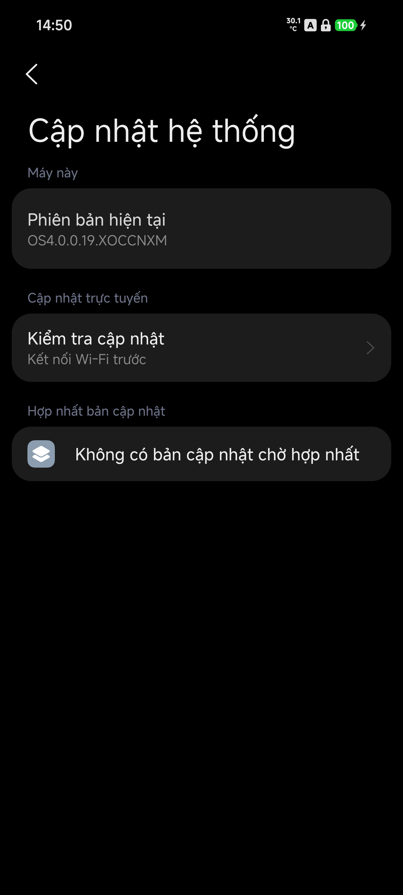
  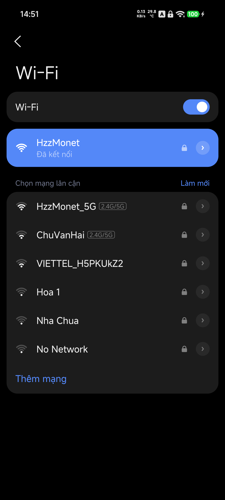
</p>

Connect to 2.4 GHz / 5 GHz Wi-Fi networks directly in recovery to check and install system OTA updates (with A/B merge status) and self-update Aweyuki Recovery.

### Backup, Restore & App Vault

<p align="center">
  
  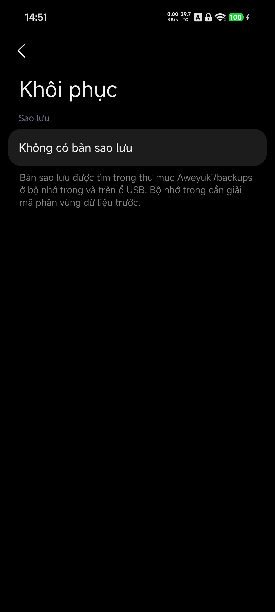
  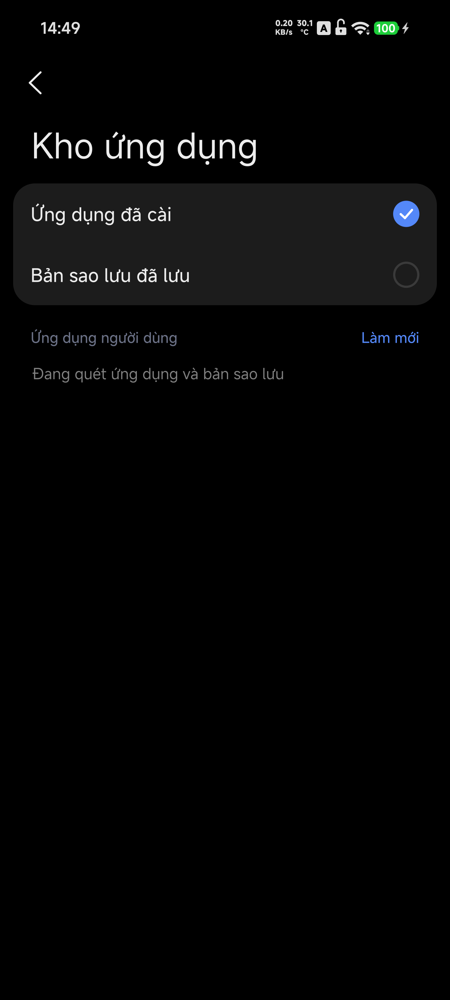
</p>

- **Backup & Restore**: Back up and restore `boot`, `system`, `data`, Modem & EFS, and optional `efisp` to Internal Storage or USB OTG with compression and verification.
- **App Vault**: Back up and restore individual user apps as `.tar.lz4` archives in `/sdcard/Aweyuki/app-vault`.

### File Manager, Mount & Terminal

<p align="center">
  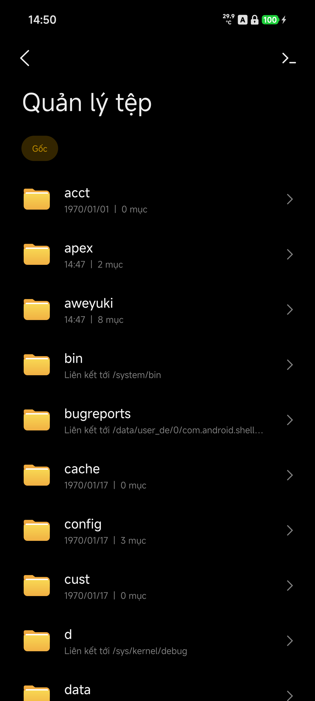
  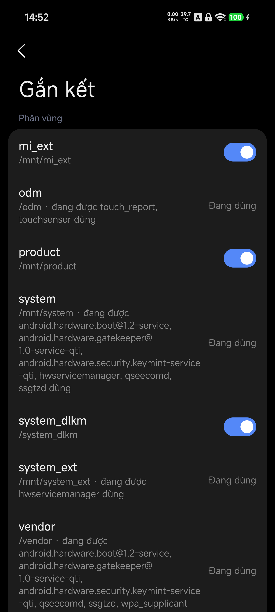
  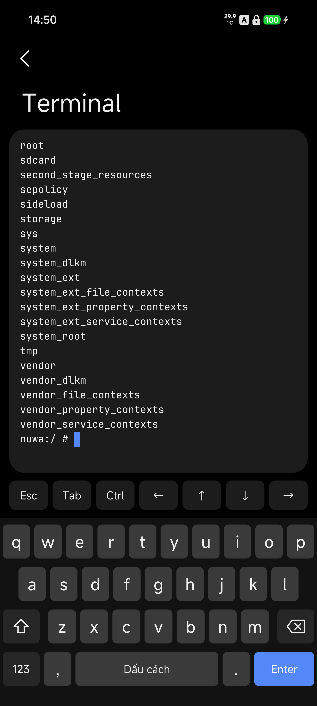
</p>

- **File Manager**: Browse `/` with file metadata, symlink targets, and a quick shortcut to the terminal.
- **Mount & USB**: Toggle dynamic partitions (`system`, `vendor`, `product`, `odm`, `mi_ext`, `system_ext`, `system_dlkm`) and manage MTP/ADB over USB.
- **Terminal**: Built-in root shell with an on-screen keyboard (`Esc`, `Tab`, `Ctrl`, and arrow keys).

### Wipe Data, SELinux & Filesystem Repair

<p align="center">
  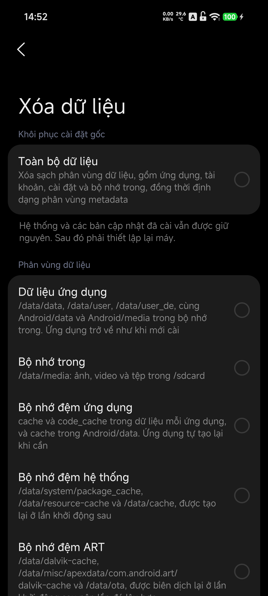
  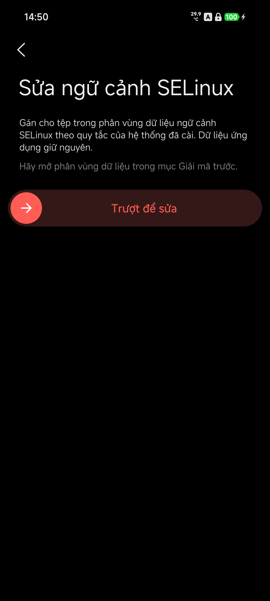
  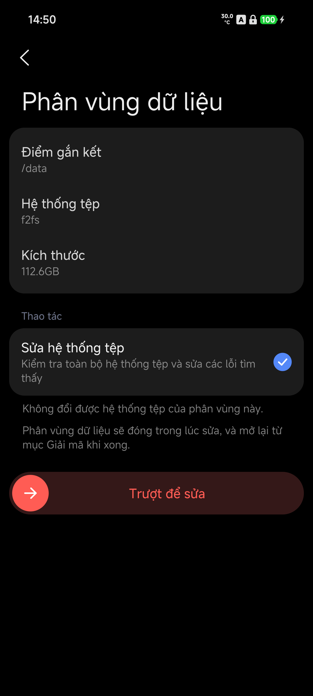
</p>

Every wipe option states clearly what it removes. Fix SELinux contexts on `/data`, check and repair `/data` (`f2fs`), and perform byte-by-byte verified zero-fill wiping for `efisp` and `frp` partitions.

### Root Manager

<p align="center">
  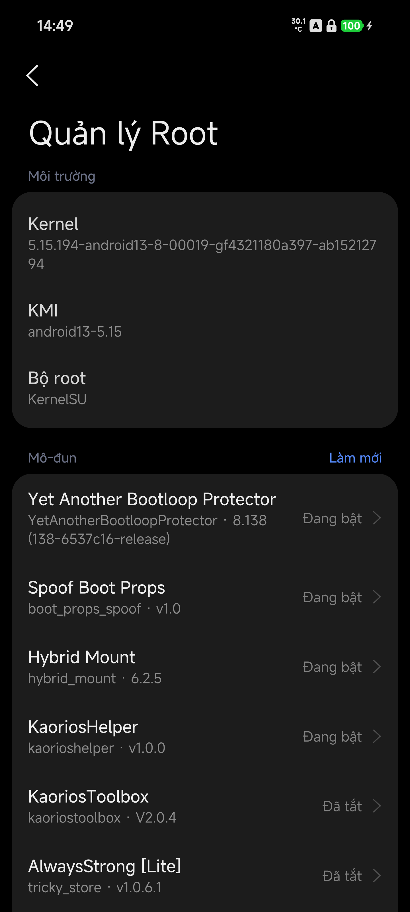
</p>

Automatically resolves kernel version and KMI (e.g. `5.15.194` / `android13-5.15`), detects Magisk, KernelSU, and APatch, and lets you enable, disable, or mark `/data/adb/modules/*` modules for removal.

### HTTP File Sharing & Remote Mirror (`/mirror`)

<p align="center">
  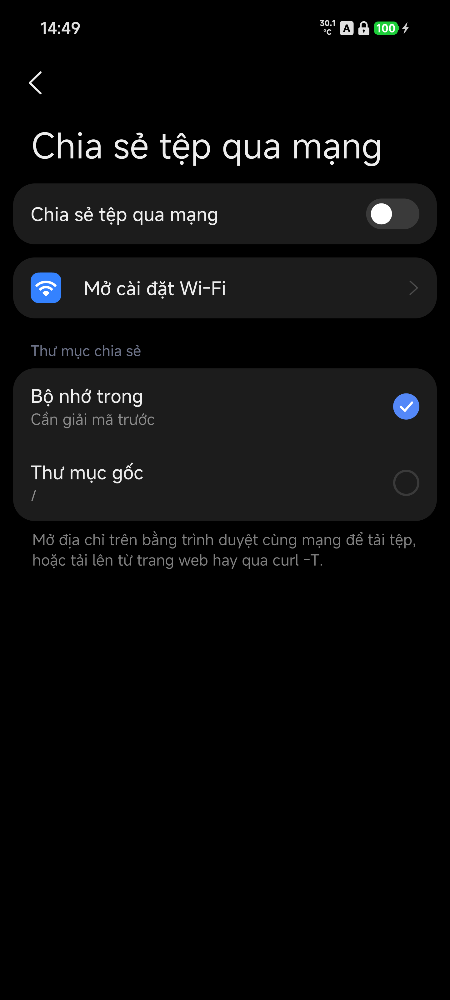
</p>

Start an HTTP/1.1 file sharing server over Wi-Fi for browser upload/download or `curl -T`, plus `/mirror` for live remote screen mirroring, touch/key control, and one-click PNG capture from a computer browser.

### Runtime Plugins & AERA `.aerap` Apps

<p align="center">
  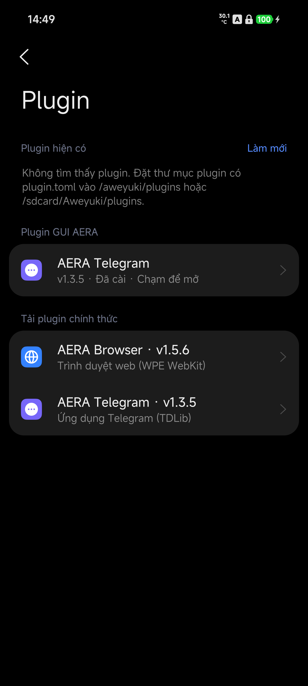
</p>

Run `plugin.toml` shell plugins with live streaming output and cancellation, alongside isolated AERA `.aerap` GUI runtimes including **AERA Browser** (WPE WebKit) and **AERA Telegram** (TDLib).

### Advanced, Developer Tools & Volume-Key-Free Screenshots

<p align="center">
  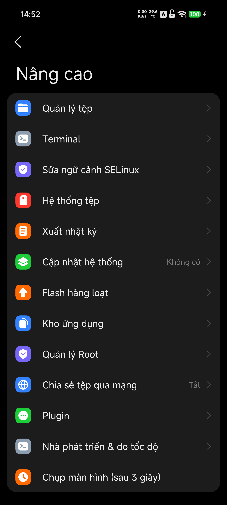
  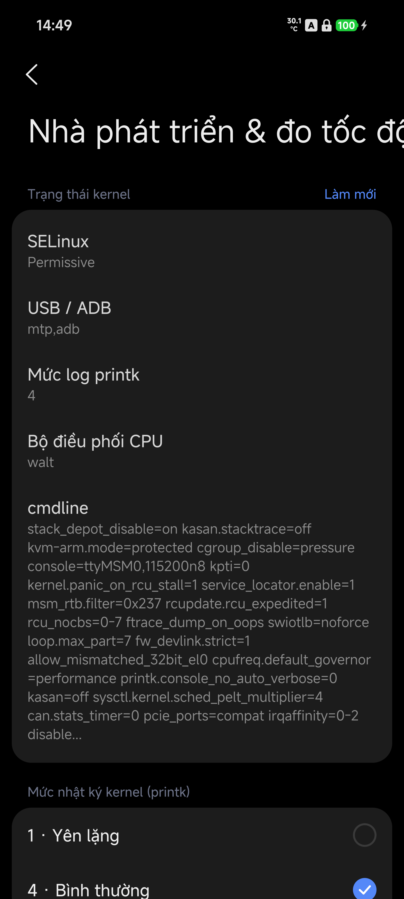
</p>

- **Advanced Hub**: Quick access to Search, Logs (with recent Flash/Wipe history), File Manager, Terminal, SELinux/Filesystem repair, Root Manager, Network File Sharing, Plugins, and App Vault.
- **Developer & Storage Benchmark**: Inspect and adjust `printk` log levels, SELinux mode, USB/ADB state, CPU governor, kernel `cmdline`, and run a 64 MiB sequential storage benchmark.
- **Volume-Key-Free Screenshots**: Capture PNG screenshots either via the **3s Delayed Screenshot** action in Advanced (the toast clears automatically before capture) or remotely from `/mirror`.

### Settings, About Phone & Reboot

<p align="center">
  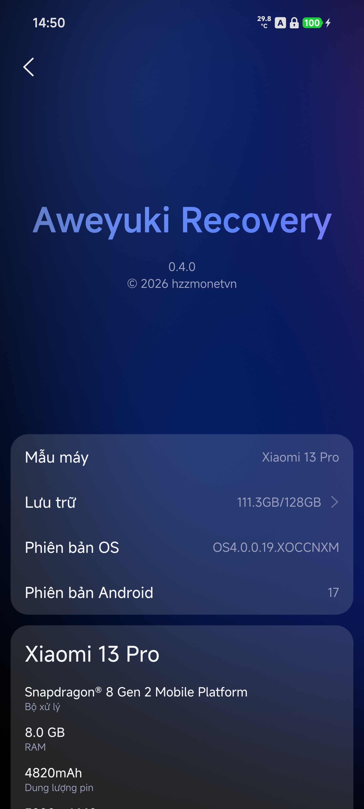
  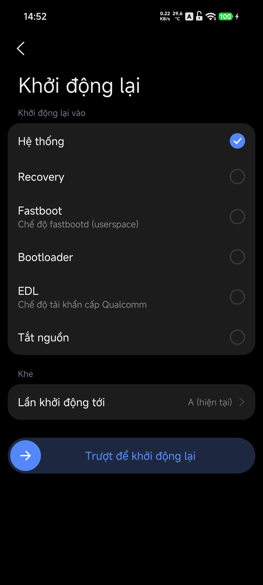
</p>

- **Localization & Themes**: Light and dark themes; 15 languages (简体中文, 繁體中文, English, Türkçe, Русский, Українська, Español, Português (Brasil), Bahasa Indonesia, Tiếng Việt, Deutsch, Français, Italiano, Polski, and 日本語); IANA time zones including Vietnam (`Asia/Ho_Chi_Minh`, UTC+7).
- **About & Diagnostics**: View Aweyuki version, storage, SoC, RAM, battery health, and charge cycles.
- **Reboot & Slot Control**: Reboot to System, Recovery, Fastboot, Bootloader, EDL, or Power off, switch A/B slots, and rely on the pre-reboot ABL EFISP regression guard.

## Supported devices

| Device | Codename | Tested system version |
| --- | --- | --- |
| Xiaomi 17 Ultra | `nezha` | OS4.0.4.0.XPACNXM (Android 17) |
| Xiaomi 13 Ultra | `ishtar` | OS3.0.308.0.WMACNXM (Android 16) |
| REDMI K60 Pro | `socrates` | OS4.0.0.24.XMKCNXM (Android 17) |
| Xiaomi 13 Pro | `nuwa` | OS3.0.312.0.WMBCNXM (Android 16) |

### 🚧 Under construction

These images are built from each phone's stock firmware and have not been tried
on the phone. They set up the screen, touch, Wi-Fi and vibration. The programs that
decrypting the data partition takes are read on the phone from the installed
system's own init scripts and service descriptions; what is read has been checked
against each model's stock firmware, and how those programs run on these models has
not been verified.

| Device | Codename | Built on |
| --- | --- | --- |
| 🚧 Xiaomi 13 | `fuxi` | OS3.0.309.0.WMCCNXM (Android 16) |
| 🚧 Xiaomi 14 | `houji` | OS3.0.307.0.WNCCNXM (Android 16) |
| 🚧 Xiaomi 14 Pro | `shennong` | OS3.0.309.0.WNBCNXM (Android 16) |
| 🚧 Xiaomi 14 Ultra | `aurora` | OS3.0.308.0.WNACNXM (Android 16) |
| 🚧 Xiaomi 15 | `dada` | OS3.0.307.0.WOCCNXM (Android 16) |
| 🚧 Xiaomi 15 Pro | `haotian` | OS3.0.309.0.WOBCNXM (Android 16) |
| 🚧 Xiaomi 15 Ultra | `xuanyuan` | OS3.0.314.0.WOACNXM (Android 16) |
| 🚧 Xiaomi 17 | `pudding` | OS4.0.4.0.XPCCNXM (Android 17) |
| 🚧 Xiaomi 17 Pro | `pandora` | OS4.0.4.0.XBLCNXM (Android 17) |
| 🚧 Xiaomi 17 Pro Max | `popsicle` | OS4.0.4.0.XPBCNXM (Android 17) |
| 🚧 Xiaomi 17 Max | `byron` | OS3.0.310.0.WAFCNXM (Android 16) |
| 🚧 REDMI K80 | `zorn` | OS3.0.309.0.WOKCNXM (Android 16) |
| 🚧 REDMI K80 Pro | `miro` | OS3.0.305.0.WOMCNXM (Android 16) |
| 🚧 REDMI K90 | `annibale` | OS3.0.307.0.WPKCNXM (Android 16) |
| 🚧 REDMI K90 Pro Max | `myron` | OS4.0.4.0.XPMCNXM (Android 17) |
| 🚧 REDMI K90 Ultra | `warsaw` | OS3.0.309.0.WHPCNXM (Android 16) |
| 🚧 REDMI K100 Pro | `athens` | OS4.0.4.0.XPICNXM (Android 17) |
| 🚧 REDMI K100 Pro Max | `songyuan` | OS4.0.4.0.XGNCNXM (Android 17) |

### Community-ported devices

Aggregated from community forks of `kirklin/skyward` (see each device's source repository link for maintainer details). Devices with `[stock]` metadata are built automatically by CI; devices marked *Local pack* can be packed locally with `aweyuki-pack` using your own stock `recovery.img` or `vendor_boot.img`.

<!-- COMMUNITY-DEVICES-START -->
| Device | Codename | Built on | Source |
| --- | --- | --- | --- |
| OnePlus ACE 6T | `OP6117L1` | Local pack (no `[stock]`) | [servant1228/skyward-plr110](https://github.com/servant1228/skyward-plr110) |
| OnePlus PLY110 (一加 Turbo 6V) | `OP64D3L1` | Local pack (no `[stock]`) | [TvTzzz/skyward-oneplus-turbo-6v](https://github.com/TvTzzz/skyward-oneplus-turbo-6v) |
| OnePlus Ace 6 | `PLQ110` | Local pack (no `[stock]`) | [liuyimeng1024-ui/skyward-for-oneplusace6](https://github.com/liuyimeng1024-ui/skyward-for-oneplusace6) |
| realme RMX3551 | `RE5465` | Local pack (no `[stock]`) | [partofpai/skyward-oplus-sm8475](https://github.com/partofpai/skyward-oplus-sm8475) |
| realme 真我Neo7 | `RMX5060` | Local pack (no `[stock]`) | [aaabbk/Realme_neo7_skyward](https://github.com/aaabbk/Realme_neo7_skyward) |
| OPPO A57 | `a57` | `lineage-22.1-20260715` | [Max1937/skyward-a57](https://github.com/Max1937/skyward-a57) |
| Redmi K40 | `alioth` | `OS1.0.10.0.TKHCNXM` | [fuxilover/skyward](https://github.com/fuxilover/skyward) |
| Redmi Note 14 Pro+ 5G | `amethyst` | `OS3.0.306.0.WOPCNXM` | [7-Ice/skyward](https://github.com/7-Ice/skyward) |
| Redmi K30S Ultra | `apollo` | Local pack (no `[stock]`) | [kafuzhi/skyward](https://github.com/kafuzhi/skyward) |
| Samsung Galaxy Z Flip4 5G | `b4q` | Local pack (no `[stock]`) | [yanzihan/Skyward-Galaxy](https://github.com/yanzihan/Skyward-Galaxy) |
| Xiaomi MIX Fold 3 | `babylon` | `OS3.0.304.0.WMVCNXM` | [zfgysyuef/skyward](https://github.com/zfgysyuef/skyward) |
| Xiaomi Redmi Note 8 Pro | `begonia` | Local pack (no `[stock]`) | [pacman-Sy/skyward](https://github.com/pacman-Sy/skyward) |
| Xiaomi MIX Flip 2 | `bixi` | `OS4.0.0.11.XOHCNXM` | [XQAB/skyward](https://github.com/XQAB/skyward) |
| motorola ThinkPhone by motorola | `bronco` | Local pack (no `[stock]`) | [iljasrb/skyward](https://github.com/iljasrb/skyward) |
| Redmi Note 9 5G | `cannon` | Local pack (no `[stock]`) | [limitbeer0/skyward-cannon](https://github.com/limitbeer0/skyward-cannon) |
| Xiaomi Mi 10 Ultra | `cas` | Local pack (no `[stock]`) | [kafuzhi/skyward](https://github.com/kafuzhi/skyward) |
| Xiaomi Mi MIX 2 | `chiron` | `V12.0.1.0.PDECNXM` | [6ewjso6-gif/skyward](https://github.com/6ewjso6-gif/skyward) |
| REDMI Note 10 Pro | `chopin` | `V14.0.8.0.TKPCNXM` | [Hwhmi/skyward](https://github.com/Hwhmi/skyward) |
| Xiaomi Mi 10 Pro | `cmi` | Local pack (no `[stock]`) | [kafuzhi/skyward](https://github.com/kafuzhi/skyward) |
| OnePlus Ace 3 Pro | `corvette` | Local pack (no `[stock]`) | [Hotsteel2901/skyward-OPA3P](https://github.com/Hotsteel2901/skyward-OPA3P) |
| Xiaomi Mi 9 Pro 5G | `crux` | Local pack (no `[stock]`) | [tao88vip/skyward](https://github.com/tao88vip/skyward) |
| Xiaomi MI 8 | `dipper` | Local pack (no `[stock]`) | [yuan-shiguang/skyward](https://github.com/yuan-shiguang/skyward) |
| Redmi K50 Ultra | `diting` | `OS3.0.3.0.VLFCNXM` | [East888666/skyward-xiaomi-legacy](https://github.com/East888666/skyward-xiaomi-legacy) |
| realme GT6 (RMX3800) | `divo` | Local pack (no `[stock]`) | [ChuiShui233/realme-pineapple-skyward](https://github.com/ChuiShui233/realme-pineapple-skyward) |
| OnePlus 13 | `dodge` | Local pack (no `[stock]`) | [Hdy08/skyward](https://github.com/Hdy08/skyward) |
| Xiaomi Pad 5 Pro 5G | `enuma` | `OS1.0.3.0.TKZCNXM` | [kayn0922/skyward](https://github.com/kayn0922/skyward) |
| OnePlus Pad 2 Pro | `erhai` | Local pack (no `[stock]`) | [Goldzxcbug/skyward](https://github.com/Goldzxcbug/skyward) |
| Redmi Note 11 5G | `evergo` | Local pack (no `[stock]`) | [SkyShadowHero/skyward_for_evergo](https://github.com/SkyShadowHero/skyward_for_evergo) |
| realme GT7 | `gt7` | Local pack (no `[stock]`) | [ReikoYuzuka/skyward](https://github.com/ReikoYuzuka/skyward) |
| realme GT8 | `gt8` | Local pack (no `[stock]`) | [ReikoYuzuka/skyward](https://github.com/ReikoYuzuka/skyward) |
| OnePlus 7 | `guacamoleb` | Local pack (no `[stock]`) | [imqinyu/skyward_guacamoleb](https://github.com/imqinyu/skyward_guacamoleb) |
| Redmi K40 Pro | `haydn` | Local pack (no `[stock]`) | [qaz6750/skyward](https://github.com/qaz6750/skyward) |
| OnePlus Ace 5 Pro | `hummer` | `v13.1` | [venti1112/skyward-hummer](https://github.com/venti1112/skyward-hummer) |
| Xiaomi Mi Note 3 | `jason` | Local pack (no `[stock]`) | [East888666/skyward-xiaomi-legacy](https://github.com/East888666/skyward-xiaomi-legacy) |
| OnePlus 8T | `kebab` | Local pack (no `[stock]`) | [toraidl/skyward](https://github.com/toraidl/skyward) |
| Xiaomi Redmi Note 7 | `lavender` | Local pack (no `[stock]`) | [aLpHa-Git-69/skyward](https://github.com/aLpHa-Git-69/skyward) |
| OnePlus 9R | `lemonades` | Local pack (no `[stock]`) | [lululuhu/skyward](https://github.com/lululuhu/skyward) |
| Xiaomi Pad 6 Pro | `liuqin` | `OS3.0.7.0.VMYCNXM` | [qasg/skyward-Xiaomio-Pad-6-Pro](https://github.com/qasg/skyward-Xiaomio-Pad-6-Pro) |
| Redmi K30 Pro | `lmi` | Local pack (no `[stock]`) | [kafuzhi/skyward](https://github.com/kafuzhi/skyward) |
| Xiaomi Civi 5 Pro | `luming` | `OS4.0.2.0.XOICNXM` | [justistab3-bot/skyward](https://github.com/justistab3-bot/skyward) |
| Meizu 20 | `m2381` | Local pack (no `[stock]`) | [un6666cn/skyward](https://github.com/un6666cn/skyward) |
| MEIZU 20 Pro | `m2391` | Local pack (no `[stock]`) | [baizhi958216/skyward](https://github.com/baizhi958216/skyward) |
| REDMI K70 Pro | `manet` | `OS3.0.307.0.WNMCNXM` | [Kinaxie/skyward](https://github.com/Kinaxie/skyward) |
| Redmi Note 12 Turbo | `marble` | `OS3.0.5.0.VMRCNXM` | [lingdiansr/skyward-marble](https://github.com/lingdiansr/skyward-marble) |
| Redmi Note 9 (Global) | `merlinx` | Local pack (no `[stock]`) | [Dracen-W/skyward-merlinx](https://github.com/Dracen-W/skyward-merlinx) |
| Xiaomi Mi-Thorium 4.19 | `mi8937_4_19` | Local pack (no `[stock]`) | [aLpHa-Git-69/skyward](https://github.com/aLpHa-Git-69/skyward) |
| Redmi K60 | `mondrian` | `OS3.0.8.0.VMNCNXM` | [Kinaxie/skyward](https://github.com/Kinaxie/skyward) |
| Xiaomi Pad 7 Pro | `muyu` | `OS4.0.3.0.XOYCNXM` | [Kinaxie/skyward](https://github.com/Kinaxie/skyward) |
| Xiaomi Pad 5 | `nabu` | Local pack (no `[stock]`) | [NekoMymaomao/skyward](https://github.com/NekoMymaomao/skyward) |
| Nubia Z70 Ultra | `nx733j` | Local pack (no `[stock]`) | [Hdy08/skyward](https://github.com/Hdy08/skyward) |
| nubia REDMAGIC 10 Pro | `nx789j` | Local pack (no `[stock]`) | [GIT-LINCC/skyward-nx789j](https://github.com/GIT-LINCC/skyward-nx789j) |
| REDMI Turbo 4 Pro | `onyx` | `OS4.0.4.0.XOLCNXM` | [Kinaxie/skyward](https://github.com/Kinaxie/skyward) |
| OPPO Find X3 | `op4e5d` | Local pack (no `[stock]`) | [toraidl/skyward](https://github.com/toraidl/skyward) |
| OnePlus Ace 6 | `op6113l1` | Local pack (no `[stock]`) | [lengyue632-commits/skyward](https://github.com/lengyue632-commits/skyward) |
| OnePlus Ace 5 | `ossi` | Local pack (no `[stock]`) | [Ral-sei/skyward-for-oneplusace5](https://github.com/Ral-sei/skyward-for-oneplusace5) |
| EEBBK X3/X5/X6A/A6/A7 | `p21h170` | Local pack (no `[stock]`) | [weikaizhi4/skyward](https://github.com/weikaizhi4/skyward) |
| EEBBK A2/X2/X2 Pro | `p22h190` | Local pack (no `[stock]`) | [weikaizhi4/skyward](https://github.com/weikaizhi4/skyward) |
| Samsung Galaxy S21 Ultra 5G | `p3q` | Local pack (no `[stock]`) | [yanzihan/Skyward-Galaxy](https://github.com/yanzihan/Skyward-Galaxy) |
| OPPO A9x | `pcem00` | Local pack (no `[stock]`) | [Winkmoon/skyward](https://github.com/Winkmoon/skyward) |
| OPPO A11x | `pchm30` | Local pack (no `[stock]`) | [hhsbjbsj/skyward](https://github.com/hhsbjbsj/skyward) |
| Xiaomi Redmi Turbo 3 | `peridot` | `OS3.0.305.0.WNPCNXM` | [hoshino114/skyward](https://github.com/hoshino114/skyward) |
| Xiaomi Pad 8 Pro | `piano` | `OS4.0.6.0.XPYCNXM` | [Kinaxie/skyward](https://github.com/Kinaxie/skyward) |
| OnePlus 15 | `plk110` | Local pack (no `[stock]`) | [liyongshun114514/skyward](https://github.com/liyongshun114514/skyward) |
| Xiaomi Mi MIX 2S | `polaris` | Local pack (no `[stock]`) | [6ewjso6-gif/skyward](https://github.com/6ewjso6-gif/skyward) |
| Xiaomi 12X | `psyche` | `OS3.0.309.0.WMCCNXM` | [abedmatar7/skyward](https://github.com/abedmatar7/skyward) |
| samsung Galaxy S20 FE 5G | `r8q` | Local pack (no `[stock]`) | [iljasrb/skyward](https://github.com/iljasrb/skyward) |
| OPPO R9s | `r9s` | Local pack (no `[stock]`) | [Max1937/skyward-a57](https://github.com/Max1937/skyward-a57) |
| Redmi K20 Pro | `raphael` | Local pack (no `[stock]`) | [6ewjso6-gif/skyward](https://github.com/6ewjso6-gif/skyward) |
| Xiaomi Mi 11 Lite 5G | `renoir` | Local pack (no `[stock]`) | [wannqn/skyward](https://github.com/wannqn/skyward) |
| realme RMX3888 | `rmx3888` | Local pack (no `[stock]`) | [maozi-114/skyward-rmx3888](https://github.com/maozi-114/skyward-rmx3888) |
| realme GT7 Pro | `rmx5010` | Local pack (no `[stock]`) | [KevinXu07/skyward](https://github.com/KevinXu07/skyward) |
| Xiaomi MIX Flip | `ruyi` | `OS3.0.305.0.WNIMIXM` | [Kinaxie/skyward](https://github.com/Kinaxie/skyward) |
| Xiaomi Mi 6 | `sagit` | Local pack (no `[stock]`) | [KextNor/skyward](https://github.com/KextNor/skyward) |
| Xiaomi Pad 6S Pro 12.4 | `sheng` | `OS3.0.303.0.WNXCNXM` | [Kinaxie/skyward](https://github.com/Kinaxie/skyward) |
| Nothing Phone (1) | `spacewar` | Local pack (no `[stock]`) | [BruxinCore/Skyward-spacewar](https://github.com/BruxinCore/Skyward-spacewar) |
| Xiaomi 11 Ultra | `star` | Local pack (no `[stock]`) | [LiAA-CN/skyward-for-Mi11P-U](https://github.com/LiAA-CN/skyward-for-Mi11P-U) |
| Lenovo Xiaoxin Pad Pro GT | `tb710fu` | Local pack (no `[stock]`) | [WASDDestroy/skyward](https://github.com/WASDDestroy/skyward) |
| Xiaomi Mi 10S | `thyme` | Local pack (no `[stock]`) | [Flicker-Android-Devices/skyward-mikona](https://github.com/Flicker-Android-Devices/skyward-mikona) |
| REDMI K Pad | `turner` | Local pack (no `[stock]`) | [xiaozhou0307/skyward](https://github.com/xiaozhou0307/skyward) |
| Xiaomi 10 | `umi` | `OS1.0.5.0.TJBCNXM` | [Alittlejelly/skyward-for-MI10](https://github.com/Alittlejelly/skyward-for-MI10) |
| Xiaomi 12S Pro | `unicorn` | `OS3.0.4.0.VLECNXM` | [Kinaxie/skyward](https://github.com/Kinaxie/skyward) |
| Xiaomi 11 | `venus` | Local pack (no `[stock]`) | [cvbyisme/skyward-venus-archive](https://github.com/cvbyisme/skyward-venus-archive) |
| Redmi K70 | `vermeer` | `OS3.0.307.0.WNKCNXM` | [luoxunyong/skyward-by-Redmi-K70](https://github.com/luoxunyong/skyward-by-Redmi-K70) |
| Xiaomi Pad 7S Pro 12.5 | `violin` | `OS4.0.5.0.XOTCNXM` | [shu-chong/skyward-for-violin](https://github.com/shu-chong/skyward-for-violin) |
| Xiaomi MI 6X | `wayne` | Local pack (no `[stock]`) | [East888666/skyward-xiaomi-legacy](https://github.com/East888666/skyward-xiaomi-legacy) |
| Redmi Note 11T Pro | `xaga` | `OS1.0.3.0.ULOCNXM` | [BkaNeko/xaga-skyward](https://github.com/BkaNeko/xaga-skyward) |
| Samsung Galaxy S20+ 5G | `y2q` | Local pack (no `[stock]`) | [yanzihan/Skyward-Galaxy](https://github.com/yanzihan/Skyward-Galaxy) |
| Xiaomi Pad 6 Max 14 | `yudi` | `OS3.0.6.0.VMHCNXM` | [HuberyBrook/skyward](https://github.com/HuberyBrook/skyward) |
| Xiaomi Pad 8 | `yupei` | `OS4.0.12.0.XPZCNXM` | [d2su8/skyward](https://github.com/d2su8/skyward) |
| Xiaomi MIX Fold 2 | `zizhan` | Local pack (no `[stock]`) | [Hdy08/skyward](https://github.com/Hdy08/skyward) |
<!-- COMMUNITY-DEVICES-END -->

### Adding a new device

GitHub Actions automatically builds and packages every `devices/*.toml` that defines a `[stock]` table on each run and release (supporting `recovery`, `vendor_boot`, Linux 4.19 / HIDL `keymaster@4.0` decryption, preset-only haptics, and dual-boot with or without `init_boot`). To add a phone not listed above:

- Create `devices/<codename>.toml` (display, touch, kernel modules, partitions, Wi-Fi, haptics, backup, logs, and the stock full OTA `[stock]` metadata).
- Extract stock init/VINTF descriptors with `aweyuki-pack described` into `crates/aweyuki-programs/tests/described/<codename>`.
- Register the expected `[stock].version` in `crates/aweyuki-config/src/lib.rs` and run `cargo test --workspace`.
- Add the device to the `🚧 Under construction` table (or the main table once verified on real hardware).

See the full walkthrough in [Adding a new device](docs/adding-devices.md) ([Tiếng Việt](docs/adding-devices.vi.md)).

## Installing Aweyuki Recovery

Aweyuki needs an unlocked bootloader. Download the zip for your phone from
[Releases](https://github.com/AweYuki/aweyuki_recovery/releases), where each shows as the
phone's model and codename, such as Xiaomi 17 Ultra (nezha). Check it against
`SHA256SUMS`, unzip it, and flash the image inside to the recovery partition of
the slot the phone runs from, with the phone in fastboot mode:

```sh
unzip aweyuki-v0.5.1-nezha-OS4.0.4.0.XPACNXM.zip
fastboot flash recovery aweyuki-v0.5.1-nezha-OS4.0.4.0.XPACNXM.img
fastboot reboot recovery
```

Afterwards Aweyuki updates itself over Wi-Fi from its newest release, on the
Aweyuki update page in Settings; a newer image, unzipped, also installs from its own
Install page. With **Flash Aweyuki again** on, a system update or zip that writes
over the recovery partitions gets Aweyuki back in them.

adb in Aweyuki is a root shell that needs no authorization on the phone: anyone
with the phone and a cable can reach its storage while it is in recovery.

## How dual boot works

Aweyuki installs a second system beside the one in the phone's own partitions,
whether that is HyperOS or a custom ROM, and switches between them from **Dual boot**
on its home page. The second system's root is a file in the data partition that the
filesystem may neither move nor delete, read and written through the partition
itself; the boot images of both systems are kept in another such file. A switch
writes only the boot and init_boot partitions of the slot that starts next, and
keeps each step on /metadata first, so a switch cut off by a loss of power is
finished when Aweyuki next starts. vendor_boot, dtbo, recovery, vbmeta, the firmware
and super stay as they are, and the second system starts with the installed
system's vendor_boot and dtbo.

Before anything else writes the boot partitions, Aweyuki puts the installed system's
boot images back: an install, a slot switch, fastboot, a factory reset, and a backup
or restore of the boot partitions. The second system waits while a system update is
still to be merged, and backups of the data partition leave it out.

A second system installs from a zip on the Install page, as any other package does:

| File | What it holds |
| --- | --- |
| `system.toml` | `id`, `name`, `version` and `filesystem`; `init`, the program the root starts with, `/sbin/init` unless given; `minimum`, the least room the root takes, in bytes |
| `boot.img` | The kernel the bootloader starts |
| `rootfs.img` | The root filesystem's image, of the `filesystem` named |
| `init_boot.img` | Only for a system with a first ramdisk of its own |

A system without an init_boot image of its own starts from one Aweyuki makes. Its
program loads the installed system's first-stage kernel modules the way that
system's first stage loads them, with their soft dependencies and the settings the
kernel command line gives them, finds the root in the data partition, mounts it and
starts `init` there. If anything stops it, it brings Aweyuki up, as a failed start
of the installed system ends in the recovery: it leaves the reason in misc, unpacks
the ramdisk of the slot's recovery partition over its own, as the kernel unpacks it
when the bootloader starts the recovery, and hands over to Aweyuki's first program,
so Aweyuki comes up however the bootloader treats a restart. Aweyuki shows why, and
the second system still starts next until the user switches on Dual boot. A start
that stops moving restarts into the recovery instead, and a phone restarted before
the hand-over finds the same request in misc at its next start, which brings
Aweyuki up before anything else. Where Aweyuki comes up neither way, the phone stays
where it stopped, and never starts the same again and again. A system with a first
ramdisk of its own finds Aweyuki's program at `/aweyuki/map`, which lays the root
out as a block device and prints its node. Each switch to the second system writes
its init_boot image with the program of the Aweyuki that switches, so an updated
Aweyuki starts it with the new program.

A running system switches by writing `boot-recovery` with
`--switch_system=installed`, or `--switch_system=` and the second system's `id`, to
misc, and restarting into recovery. Where the bootloader starts the slot again, as
the 13 Ultra's can with a USB cable in, Aweyuki's program finds the request in misc
at the next start and brings Aweyuki up before anything else.

## Building

Aweyuki builds with the version of Rust that `rust-toolchain.toml` names, with its
`aarch64-linux-android` target, the Android NDK r29 and
[cargo-ndk](https://github.com/bbqsrc/cargo-ndk). The recovery service is built for
the phone, and the packer for the computer:

```sh
cargo ndk -t arm64-v8a --platform 30 build --release -p aweyuki
cargo build --release -p aweyuki-pack
```

The second system's first program runs before any library is there to load, so it
is built as a static program:

```sh
RUSTFLAGS="-C target-feature=+crt-static" cargo ndk -t arm64-v8a --platform 30 build --release -p aweyuki-system-init --target-dir target/system-init
```

The packer takes the stock recovery partition out of the build's full update
package on Xiaomi's server, reading only the part of the package the partition is
in, and checks its SHA-256 against the device file:

```sh
target/release/aweyuki-pack stock --config devices/nezha.toml --out target/stock/nezha/recovery.img
```

Then it builds the image on top of it:

```sh
target/release/aweyuki-pack recovery \
  --stock target/stock/nezha/recovery.img \
  --binary target/aarch64-linux-android/release/aweyuki \
  --system-init target/system-init/aarch64-linux-android/release/system-init \
  --config devices/nezha.toml \
  --font resources/fonts/MiSansVF.ttf \
  --mono resources/fonts/KirkMono-Regular.ttf \
  --mono-license resources/fonts/KirkMono-OFL.txt \
  --out target/aweyuki-nezha.img
```

Tests and lints run on the computer; what runs only on the phone is linted for it:

```sh
cargo test --workspace
cargo clippy --workspace --all-targets -- -D warnings
cargo ndk -t arm64-v8a --platform 30 clippy --workspace --all-targets -- -D warnings
```

The tests whose names start with `on_the_phone` make filesystems, mount them and
set encryption keys, which only a phone does. With a phone in Aweyuki attached over
adb, its data partition open, `cargo ndk` pushes each test program to the phone and
runs it there, one test at a time:

```sh
cargo ndk -t arm64-v8a --platform 30 test -p aweyuki -p aweyuki-block -p aweyuki-files -p aweyuki-mtp on_the_phone -- --test-threads=1
```

`aweyuki-preview` draws the pages on the computer, as PNG files, without a phone:
each page whole, as a long screenshot shows it, in the states it can be in, and the
screen at moments of touches and motion. `--lang` picks the language by a locale
such as `en` or `zh-TW`:

```sh
cargo run --release -p aweyuki-preview -- target/preview --lang en
```

### Translations

Each language's texts are one file in `crates/aweyuki-ui/locales`, named by its
locale: `tr.toml`, `pt-BR.toml`. `en.toml` is the reference, with a comment on
where each text shows. The build reads every file and stops on a text that is
missing, or that names a value in braces the English text does not.

To correct a translation, change its text in the language's file. To check how it
looks, draw the pages in that language with `aweyuki-preview --lang`. With each
page, it says which texts did not fit their place: `cut short in` for a text that
ends in an ellipsis, `set at 80% in` for a label set smaller to fit its key, button
or slider, `past the edge in` for a text that runs off the screen, and `overlap in`
for two texts that run into each other.

## Credits

- [Skyward](https://github.com/kirklin/skyward) by Kirk Lin — original Rust recovery architecture and UI foundation.
- [AERA Recovery](https://github.com/AERA-Recovery) — inspiration and design reference for EFISP, Root Manager, network file sharing, and runtime plugins.

## License

[GPL-3.0-or-later](LICENSE)
