# Aweyuki Recovery

[English](README.md) | [简体中文](README.zh-CN.md) | Tiếng Việt

Aweyuki Recovery là một recovery Android viết lại từ đầu bằng Rust.

<p align="center">
  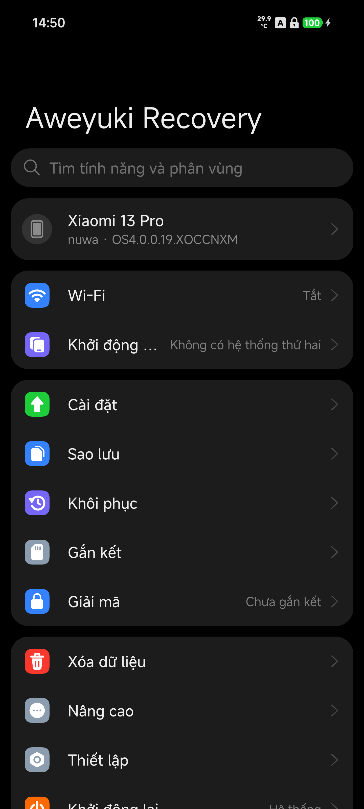
  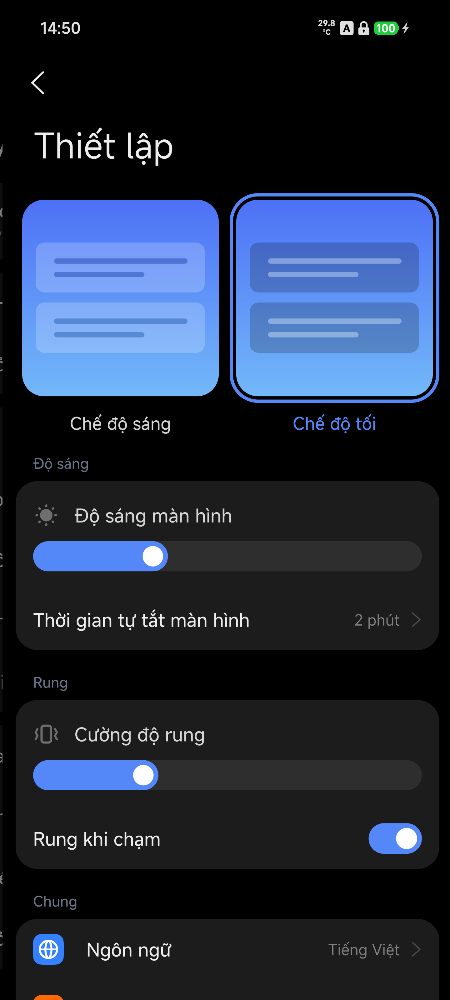
  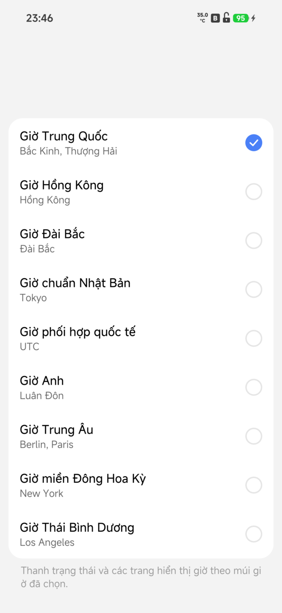
</p>

## Tính năng

### Khởi động kép

<p align="center">
  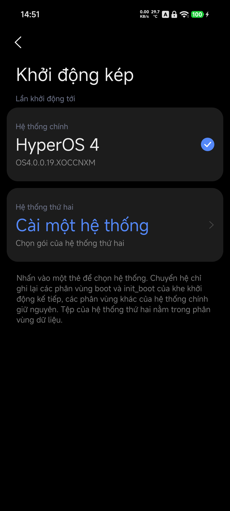
</p>

Cài đặt hệ thống thứ hai song song với ROM hiện tại (HyperOS hoặc ROM tùy biến) với cơ chế chuyển đổi nguyên tử qua `/metadata`, chỉ ghi vào `boot` và `init_boot`. Cách đóng gói và khởi động hệ thống thứ hai có ở [Cách khởi động kép hoạt động](#cách-khởi-động-kép-hoạt-động).

### Giải mã & Khóa PIN Recovery

<p align="center">
  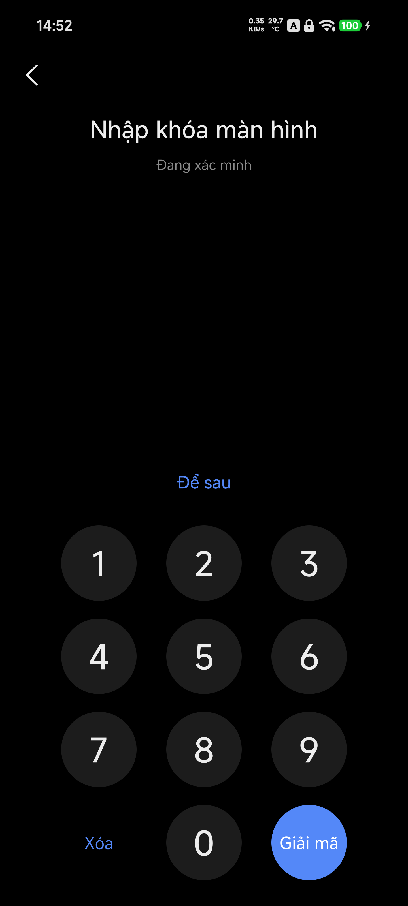
</p>

Giải mã `/data` bằng mã PIN, hình vẽ hoặc mật khẩu khóa màn hình của hệ thống, đồng thời hỗ trợ đặt khóa PIN riêng cho recovery để bảo vệ quyền truy cập.

### Cài đặt, Kiểm tra OTA Payload & Flash hàng loạt

<p align="center">
  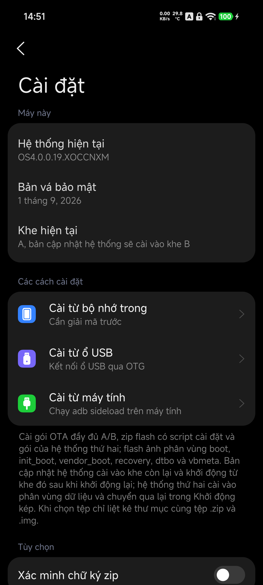
  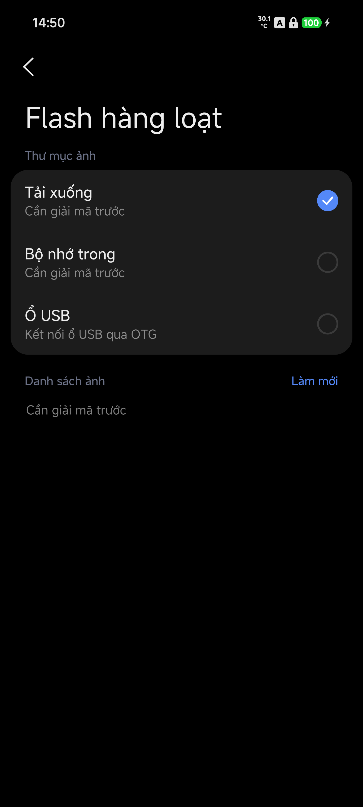
</p>

- **Nguồn cài đặt & công cụ**: Flash tệp `.zip`, `.img`, `.efi` và gói khởi động kép từ Bộ nhớ trong, USB OTG hoặc ADB Sideload kèm tùy chọn kiểm tra chữ ký zip. Script cài đặt có sẵn `7za`, `zstd`, `unzip -p` đọc luồng trực tiếp, `avbctl` và `resetprop`.
- **Trình kiểm tra OTA Payload & ARB**: Đọc manifest của `payload.bin` / OTA `.zip`, kiểm tra chống hạ cấp (Anti-Rollback / ARB) và trích xuất phân vùng (`REPLACE`, `REPLACE_ZSTD`, `ZERO`, `DISCARD`).
- **Flash hàng loạt & EFISP**: Chọn và flash nhiều ảnh `.img`/`.efi` cùng lúc có kiểm tra kích thước phân vùng, hỗ trợ flash trực tiếp ảnh ARM64 `.efi` vào phân vùng `efisp` không phân khe.

### Cập nhật trực tuyến & Wi-Fi

<p align="center">
  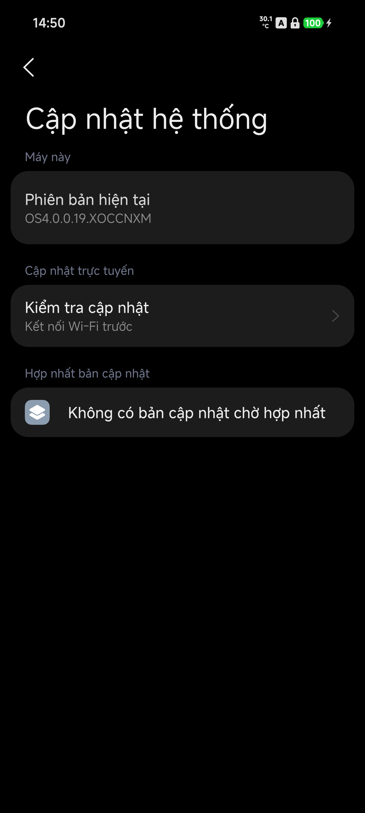
  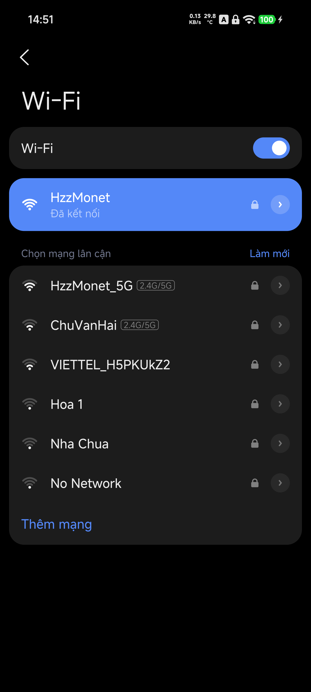
</p>

Kết nối Wi-Fi 2.4 GHz / 5 GHz ngay trong recovery để kiểm tra, cài đặt cập nhật hệ thống (kèm trạng thái hợp nhất A/B) và tự cập nhật Aweyuki Recovery.

### Sao lưu, Khôi phục & Kho ứng dụng

<p align="center">
  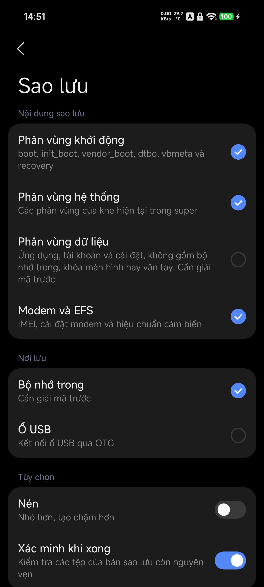
  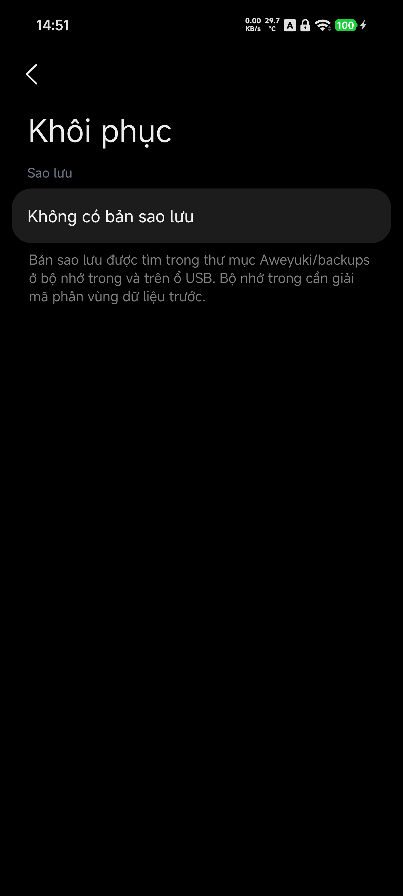
  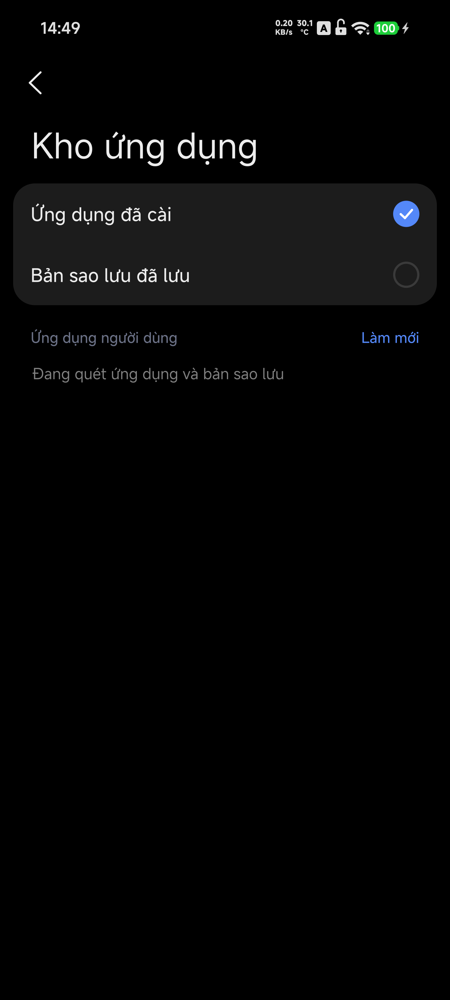
</p>

- **Sao lưu & Khôi phục**: Sao lưu và khôi phục `boot`, `system`, `data`, Modem & EFS và tùy chọn `efisp` ra Bộ nhớ trong hoặc USB OTG với nén và kiểm tra toàn vẹn.
- **Kho ứng dụng (App Vault)**: Sao lưu và khôi phục từng ứng dụng người dùng dạng `.tar.lz4` tại `/sdcard/Aweyuki/app-vault`.

### Trình quản lý tệp, Gắn kết & Terminal

<p align="center">
  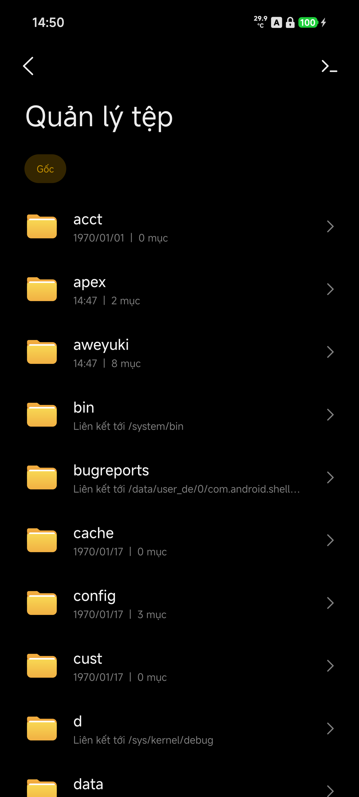
  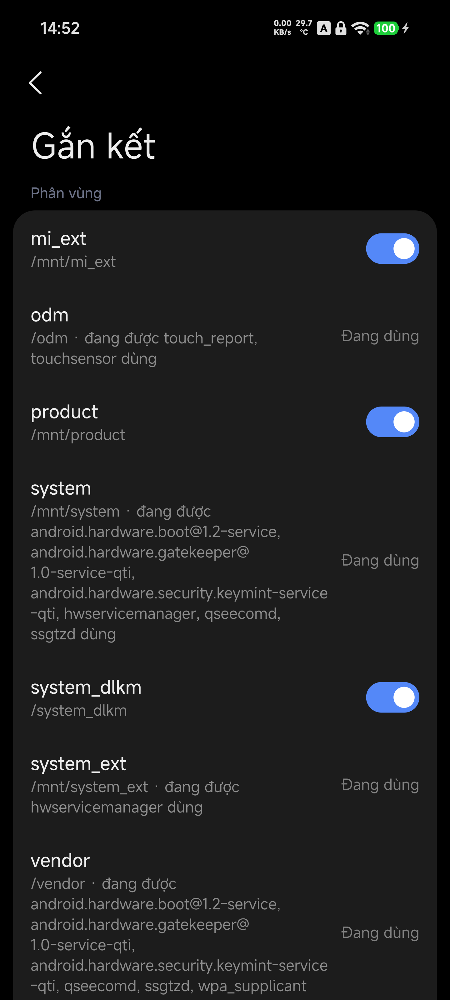
  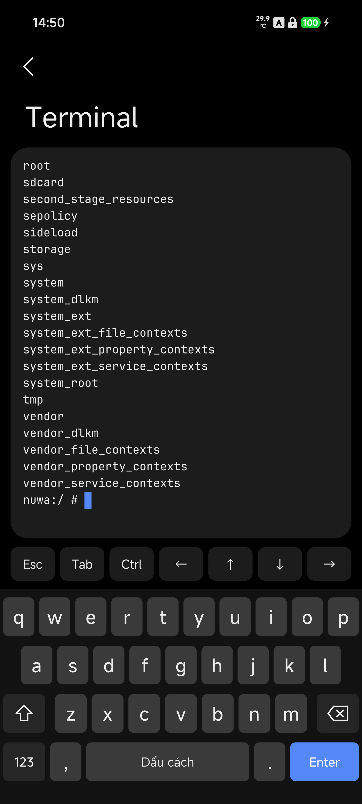
</p>

- **Trình quản lý tệp**: Duyệt thư mục `/` với thông tin chi tiết, đích liên kết tượng trưng (symlink) và nút mở nhanh Terminal.
- **Gắn kết & USB**: Bật/tắt gắn kết phân vùng động (`system`, `vendor`, `product`, `odm`, `mi_ext`, `system_ext`, `system_dlkm`) và quản lý kết nối MTP/ADB qua USB.
- **Terminal**: Shell root tích hợp sẵn bàn phím trên màn hình (`Esc`, `Tab`, `Ctrl`, các phím mũi tên).

### Xóa dữ liệu, SELinux & Sửa hệ thống tệp

<p align="center">
  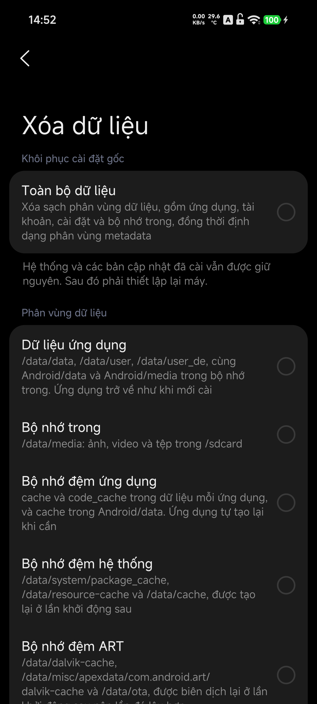
  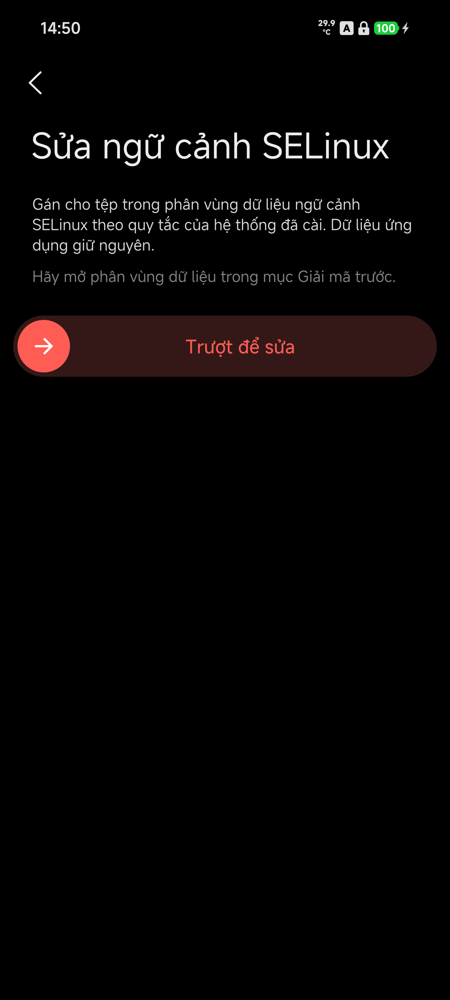
  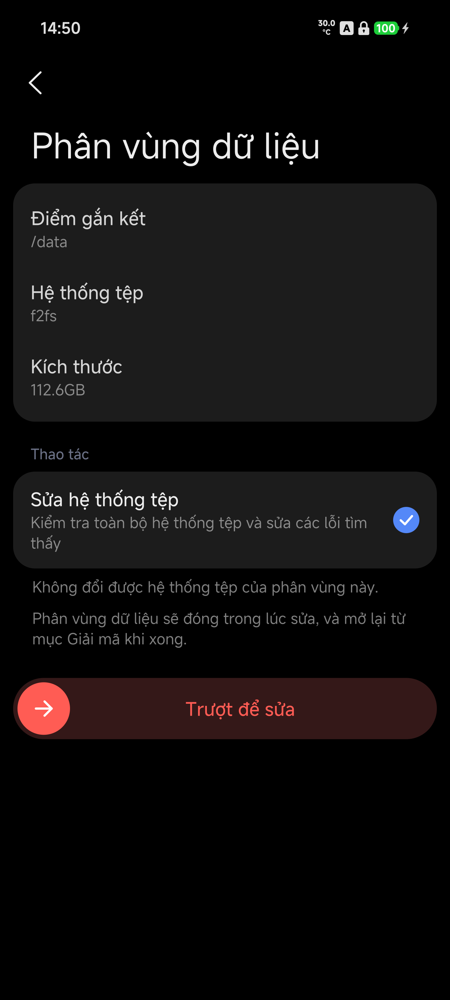
</p>

Mỗi tùy chọn xóa đều ghi rõ phạm vi tác động. Hỗ trợ sửa ngữ cảnh SELinux cho `/data`, kiểm tra và sửa chữa hệ thống tệp `/data` (`f2fs`), cùng xóa ghi số 0 kiểm tra từng byte cho phân vùng `efisp` và `frp`.

### Quản lý Root

<p align="center">
  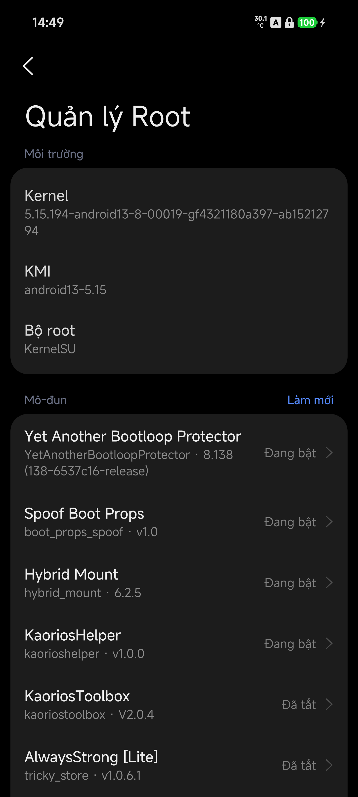
</p>

Tự động nhận diện phiên bản nhân và KMI (ví dụ `5.15.194` / `android13-5.15`), phát hiện Magisk, KernelSU, APatch và cho phép bật, tắt hoặc đánh dấu gỡ mô-đun trong `/data/adb/modules/*`.

### Chia sẻ tệp qua mạng & Điều khiển từ xa (`/mirror`)

<p align="center">
  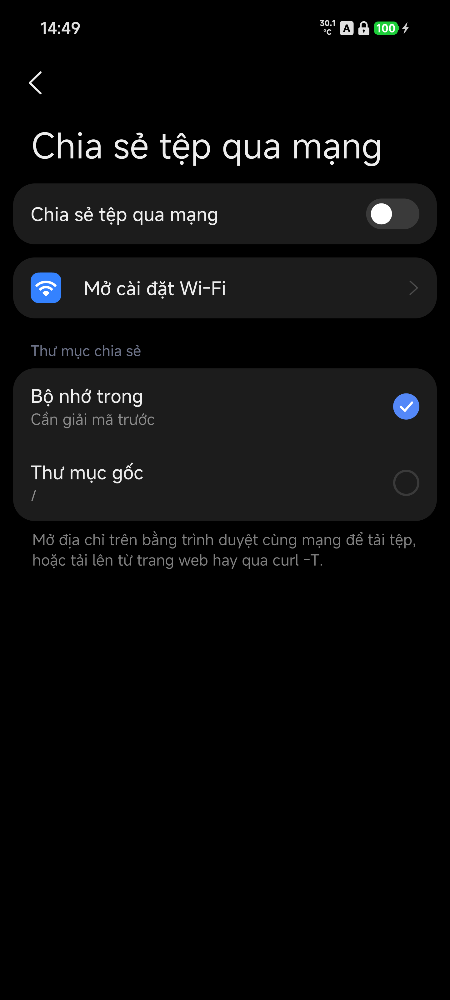
</p>

Bật máy chủ chia sẻ tệp HTTP/1.1 qua Wi-Fi để tải lên/tải xuống trên trình duyệt hoặc qua `curl -T`, kèm trang `/mirror` phản chiếu màn hình trực tiếp, điều khiển cảm ứng/phím bấm và lưu ảnh PNG từ trình duyệt máy tính.

### Tiện ích mở rộng & Ứng dụng AERA `.aerap`

<p align="center">
  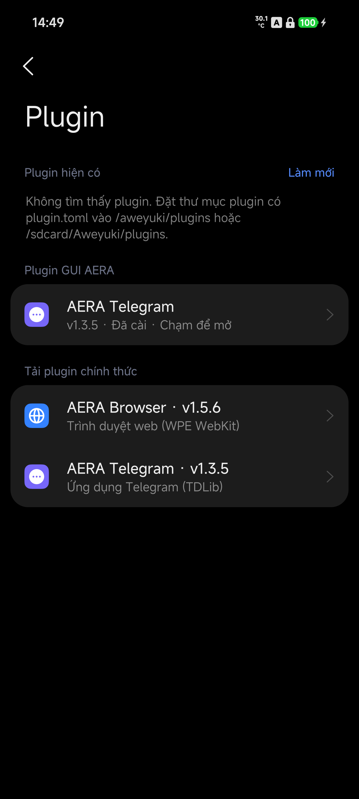
</p>

Chạy các plugin script `plugin.toml` với luồng đầu ra trực tiếp và khả năng dừng ngang, đồng thời hỗ trợ các gói GUI AERA `.aerap` chạy cách ly như **AERA Browser** (WPE WebKit) và **AERA Telegram** (TDLib).

### Nâng cao, Công cụ nhà phát triển & Chụp màn hình không cần phím cứng

<p align="center">
  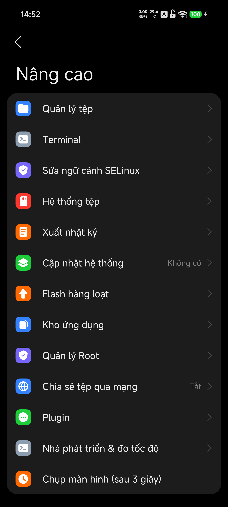
  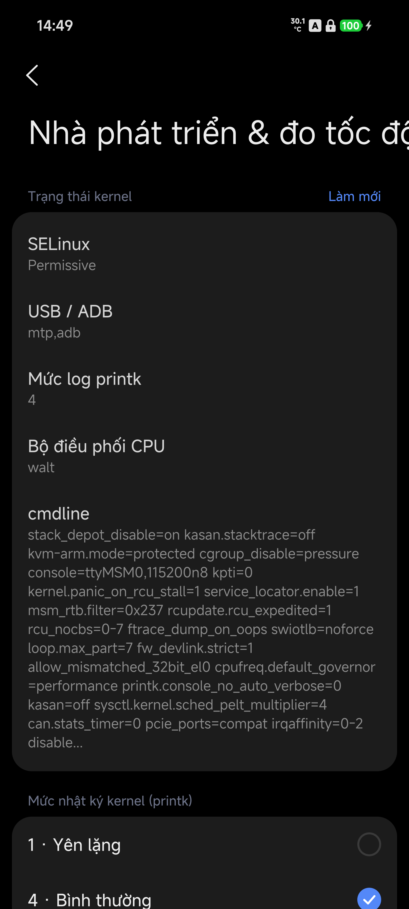
</p>

- **Menu Nâng cao**: Truy cập nhanh Tìm kiếm, Nhật ký (gồm lịch sử Flash/Xóa gần đây), Trình quản lý tệp, Terminal, sửa SELinux/hệ thống tệp, Quản lý Root, Chia sẻ tệp qua mạng, Plugin và Kho ứng dụng.
- **Nhà phát triển & Đo tốc độ**: Xem và chỉnh mức log `printk`, trạng thái SELinux, USB/ADB, bộ điều phối CPU, `cmdline` nhân và chạy bài đo tốc độ đọc/ghi tuần tự 64 MiB.
- **Chụp màn hình không cần phím âm lượng**: Chụp ảnh PNG qua mục **Chụp màn hình (sau 3 giây)** trong Nâng cao (thông báo tự ẩn trước khi chụp) hoặc chụp trực tiếp từ `/mirror`.

### Thiết lập, Thông tin máy & Khởi động lại

<p align="center">
  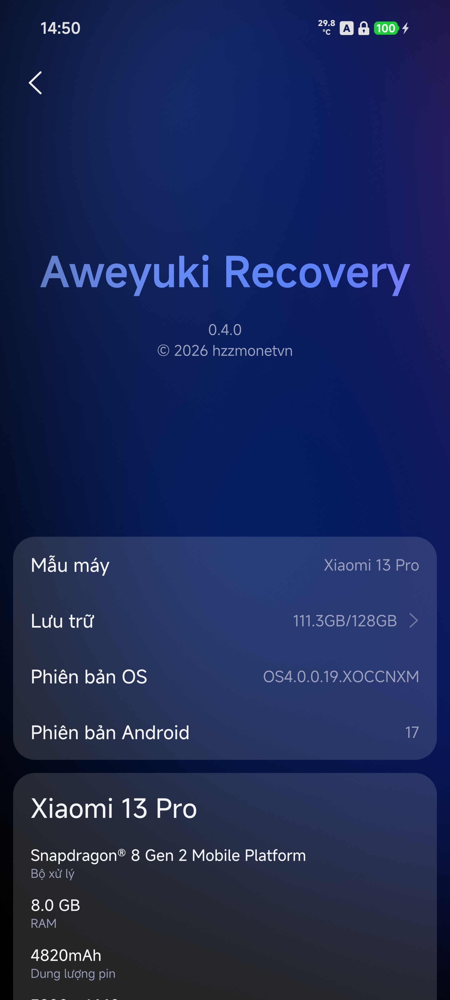
  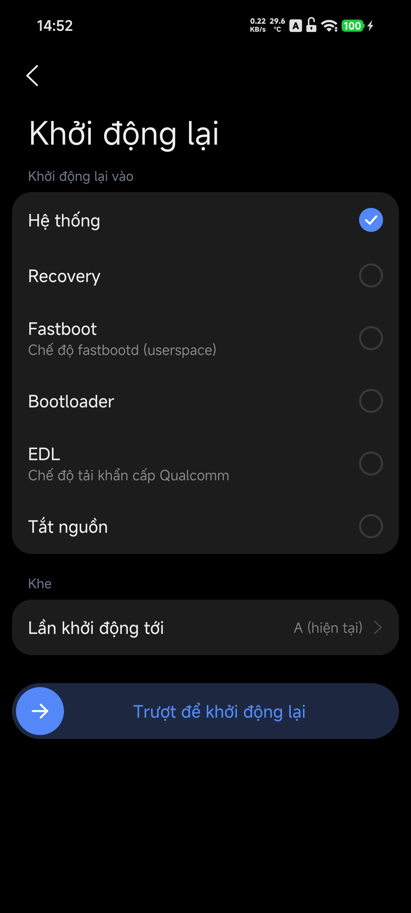
</p>

- **Ngôn ngữ & Giao diện**: Giao diện sáng/tối; hỗ trợ tiếng Việt, tiếng Anh, tiếng Trung giản thể và phồn thể; 28 múi giờ IANA bao gồm Việt Nam (`Asia/Ho_Chi_Minh`, UTC+7).
- **Thông tin máy**: Xem phiên bản Aweyuki, dung lượng lưu trữ, SoC, RAM, tình trạng pin và số chu kỳ sạc.
- **Khởi động lại & Chọn khe**: Khởi động lại vào Hệ thống, Recovery, Fastboot, Bootloader, EDL hoặc Tắt nguồn, chuyển khe A/B và cảnh báo ABL mất bộ nạp EFISP trước khi khởi động lại.

## Thiết bị hỗ trợ

| Thiết bị | Tên mã | Phiên bản hệ thống đã thử |
| --- | --- | --- |
| Xiaomi 17 Ultra | `nezha` | OS4.0.4.0.XPACNXM (Android 17) |
| Xiaomi 13 Ultra | `ishtar` | OS3.0.308.0.WMACNXM (Android 16) |
| Xiaomi 13 Pro | `nuwa` | OS3.0.312.0.WMBCNXM (Android 16) |

### 🚧 Đang hoàn thiện

Các ảnh này được dựng từ firmware gốc của từng máy và chưa được thử trên điện thoại. Chúng
cấu hình màn hình, cảm ứng, Wi-Fi và rung. Các chương trình cần cho việc giải mã phân
vùng dữ liệu được đọc ngay trên máy từ script init và mô tả dịch vụ của hệ thống đã cài;
những gì đọc được đã đối chiếu với firmware gốc của từng mẫu, còn cách các chương
trình đó chạy trên những mẫu này thì chưa được kiểm chứng.

| Thiết bị | Tên mã | Dựng trên |
| --- | --- | --- |
| 🚧 Xiaomi 13 | `fuxi` | OS3.0.309.0.WMCCNXM (Android 16) |
| 🚧 Xiaomi 14 | `houji` | OS3.0.307.0.WNCCNXM (Android 16) |
| 🚧 Xiaomi 14 Pro | `shennong` | OS3.0.309.0.WNBCNXM (Android 16) |
| 🚧 Xiaomi 14 Ultra | `aurora` | OS3.0.308.0.WNACNXM (Android 16) |
| 🚧 Xiaomi 15 | `dada` | OS3.0.307.0.WOCCNXM (Android 16) |
| 🚧 Xiaomi 15 Pro | `haotian` | OS3.0.309.0.WOBCNXM (Android 16) |
| 🚧 Xiaomi 15 Ultra | `xuanyuan` | OS3.0.314.0.WOACNXM (Android 16) |
| 🚧 Xiaomi 17 | `pudding` | OS4.0.4.0.XPCCNXM (Android 17) |
| 🚧 Xiaomi 17 Pro | `pandora` | OS4.0.4.0.XBLCNXM (Android 17) |
| 🚧 Xiaomi 17 Pro Max | `popsicle` | OS4.0.4.0.XPBCNXM (Android 17) |
| 🚧 Xiaomi 17 Max | `byron` | OS3.0.310.0.WAFCNXM (Android 16) |
| 🚧 REDMI K80 | `zorn` | OS3.0.309.0.WOKCNXM (Android 16) |
| 🚧 REDMI K80 Pro | `miro` | OS3.0.305.0.WOMCNXM (Android 16) |
| 🚧 REDMI K90 | `annibale` | OS3.0.307.0.WPKCNXM (Android 16) |
| 🚧 REDMI K90 Pro Max | `myron` | OS4.0.4.0.XPMCNXM (Android 17) |
| 🚧 REDMI K90 Ultra | `warsaw` | OS3.0.309.0.WHPCNXM (Android 16) |
| 🚧 REDMI K100 Pro | `athens` | OS4.0.4.0.XPICNXM (Android 17) |
| 🚧 REDMI K100 Pro Max | `songyuan` | OS4.0.4.0.XGNCNXM (Android 17) |

### Thêm thiết bị mới

GitHub Actions tự động phát hiện và đóng gói mọi tệp cấu hình nằm trong `devices/*.toml` khi phát hành bản mới. Để thêm một mẫu máy ngoài danh sách trên:

- Tạo tệp `devices/<codename>.toml` (khai báo màn hình, cảm ứng, module kernel, phân vùng, Wi-Fi, rung, sao lưu và đường dẫn log) cùng `[stock]` trỏ tới gói Full OTA gốc.
- Trích xuất mô tả init/VINTF từ gói OTA bằng `aweyuki-pack described` vào `crates/aweyuki-programs/tests/described/<codename>`.
- Đăng ký phiên bản gốc vào test trong `crates/aweyuki-config/src/lib.rs` và chạy `cargo test --workspace`.
- Đưa máy vào bảng `🚧 Đang hoàn thiện` (hoặc bảng chính sau khi đã xác minh đầy đủ trên máy thật).

Xem chi tiết tại [Hướng dẫn thêm thiết bị mới](docs/adding-devices.vi.md) ([English](docs/adding-devices.md)).

## Cài Aweyuki Recovery

Aweyuki cần bootloader đã mở khóa. Tải zip cho máy của bạn từ
[Releases](https://github.com/AweYuki/aweyuki_recovery/releases), mỗi bản ghi rõ mẫu
máy và tên mã, chẳng hạn Xiaomi 17 Ultra (nezha). Đối chiếu với `SHA256SUMS`, giải
nén, rồi flash ảnh bên trong vào phân vùng recovery của khe máy đang chạy, khi máy ở
chế độ fastboot:

```sh
unzip aweyuki-v0.4.0-nezha-OS4.0.4.0.XPACNXM.zip
fastboot flash recovery aweyuki-v0.4.0-nezha-OS4.0.4.0.XPACNXM.img
fastboot reboot recovery
```

Sau đó Aweyuki tự cập nhật qua Wi-Fi từ bản phát hành mới nhất, trong trang cập nhật
Aweyuki ở Cài đặt; một ảnh mới hơn, đã giải nén, cũng cài được từ trang Cài đặt của
nó. Khi bật **Flash lại Aweyuki**, một bản cập nhật hệ thống hay zip ghi đè lên các
phân vùng recovery sẽ được Aweyuki ghi trở lại vào đó.

adb trong Aweyuki là shell root không cần cấp quyền trên máy: ai có máy và cáp đều
truy cập được bộ nhớ của máy khi nó đang ở recovery.

## Cách khởi động kép hoạt động

Aweyuki cài một hệ thống thứ hai bên cạnh hệ thống trong các phân vùng của máy, dù đó
là HyperOS hay một ROM tùy chỉnh, và chuyển đổi giữa hai hệ thống từ **Khởi động kép**
ở trang chủ. Gốc của hệ thống thứ hai là một tệp trong phân vùng dữ liệu mà hệ thống tệp
không được phép di chuyển hay xóa, đọc và ghi xuyên qua chính phân vùng đó; ảnh khởi
động của cả hai hệ thống nằm trong một tệp như vậy khác. Mỗi lần chuyển chỉ ghi vào
các phân vùng boot và init_boot của khe khởi động kế tiếp, và ghi từng bước vào
/metadata trước, nên một lần chuyển bị mất điện cắt ngang sẽ được hoàn tất khi Aweyuki
khởi động lần sau. vendor_boot, dtbo, recovery, vbmeta, firmware và super giữ nguyên,
và hệ thống thứ hai khởi động bằng vendor_boot và dtbo của hệ thống đã cài.

Trước khi bất cứ thứ gì khác ghi vào các phân vùng boot, Aweyuki ghi lại ảnh khởi động
của hệ thống đã cài: một lần cài đặt, một lần chuyển khe, fastboot, khôi phục cài đặt
gốc, và sao lưu hay khôi phục các phân vùng boot. Hệ thống thứ hai chờ trong khi một
bản cập nhật hệ thống còn chờ hợp nhất, và bản sao lưu phân vùng dữ liệu bỏ nó ra ngoài.

Hệ thống thứ hai cài từ một zip ở trang Cài đặt, như mọi gói khác:

| Tệp | Nội dung |
| --- | --- |
| `system.toml` | `id`, `name`, `version` và `filesystem`; `init`, chương trình mà gốc khởi động bằng, `/sbin/init` nếu không ghi; `minimum`, dung lượng tối thiểu gốc cần, tính bằng byte |
| `boot.img` | Kernel mà bootloader khởi động |
| `rootfs.img` | Ảnh của hệ thống tệp gốc, theo `filesystem` đã ghi |
| `init_boot.img` | Chỉ cho hệ thống có ramdisk đầu tiên của riêng nó |

Một hệ thống không có init_boot riêng khởi động từ ảnh Aweyuki tạo. Chương trình trong
đó nạp các module kernel giai đoạn đầu của hệ thống đã cài, đúng như giai đoạn đầu
của hệ thống đó nạp, kèm phụ thuộc mềm và tham số dòng lệnh kernel dành cho chúng,
tìm gốc trong phân vùng dữ liệu, gắn kết và chạy `init` ở đó. Nếu có gì chặn nó, nó đưa
Aweyuki lên, như một lần khởi động hỏng của hệ thống đã cài kết thúc trong recovery:
nó để lý do trong misc, giải nén ramdisk của phân vùng recovery thuộc khe đè lên
ramdisk của chính nó, đúng như kernel giải nén khi bootloader khởi động recovery, rồi
chuyển cho chương trình đầu tiên của Aweyuki, nên Aweyuki vẫn lên dù bootloader xử lý
việc khởi động lại thế nào. Aweyuki hiện lý do, và hệ thống thứ hai vẫn khởi động ở
lần tới cho đến khi người dùng chuyển trong Khởi động kép. Một lần khởi động không
tiến triển thì thay vào đó khởi động lại vào recovery, và một máy bị khởi động lại
trước lúc bàn giao sẽ thấy cùng yêu cầu đó trong misc ở lần khởi động sau, đưa Aweyuki
lên trước mọi thứ khác. Khi Aweyuki không lên được bằng cả hai cách, máy dừng ở chỗ nó
dừng, và không khởi động lại cùng một hệ thống hết lần này đến lần khác. Một hệ thống
có ramdisk đầu tiên riêng tìm chương trình của Aweyuki ở `/aweyuki/map`, chương trình
này dựng gốc thành một thiết bị khối và in ra nút của nó. Mỗi lần chuyển sang hệ thống
thứ hai đều ghi ảnh init_boot của nó bằng chương trình của chính Aweyuki đang chuyển,
nên một Aweyuki đã cập nhật sẽ khởi động nó bằng chương trình mới.

Một hệ thống đang chạy chuyển đổi bằng cách ghi `boot-recovery` với
`--switch_system=installed`, hoặc `--switch_system=` và `id` của hệ thống thứ hai, vào
misc, rồi khởi động lại vào recovery. Khi bootloader khởi động lại chính khe đó, như
máy 13 Ultra có thể làm khi cắm cáp USB, chương trình của Aweyuki thấy yêu cầu trong
misc ở lần khởi động sau và đưa Aweyuki lên trước mọi thứ khác.

## Xây dựng

Aweyuki được xây bằng phiên bản Rust mà `rust-toolchain.toml` ghi, với target
`aarch64-linux-android`, Android NDK r29 và
[cargo-ndk](https://github.com/bbqsrc/cargo-ndk). Dịch vụ recovery được xây cho điện
thoại, còn công cụ đóng gói cho máy tính:

```sh
cargo ndk -t arm64-v8a --platform 30 build --release -p aweyuki
cargo build --release -p aweyuki-pack
```

Chương trình đầu tiên của hệ thống thứ hai chạy trước khi có bất kỳ thư viện nào để
nạp, nên được xây thành chương trình tĩnh:

```sh
RUSTFLAGS="-C target-feature=+crt-static" cargo ndk -t arm64-v8a --platform 30 build --release -p aweyuki-system-init --target-dir target/system-init
```

Công cụ đóng gói lấy phân vùng recovery gốc ra khỏi gói cập nhật đầy đủ của bản dựng
trên máy chủ Xiaomi, chỉ đọc phần của gói chứa phân vùng đó, và đối chiếu SHA-256 với
tệp thiết bị:

```sh
target/release/aweyuki-pack stock --config devices/nezha.toml --out target/stock/nezha/recovery.img
```

Rồi dựng ảnh trên nền nó:

```sh
target/release/aweyuki-pack recovery \
  --stock target/stock/nezha/recovery.img \
  --binary target/aarch64-linux-android/release/aweyuki \
  --system-init target/system-init/aarch64-linux-android/release/system-init \
  --config devices/nezha.toml \
  --font resources/fonts/MiSansVF.ttf \
  --mono resources/fonts/KirkMono-Regular.ttf \
  --mono-license resources/fonts/KirkMono-OFL.txt \
  --out target/aweyuki-nezha.img
```

Test và lint chạy trên máy tính; phần chỉ chạy trên điện thoại được lint theo target
điện thoại:

```sh
cargo test --workspace
cargo clippy --workspace --all-targets -- -D warnings
cargo ndk -t arm64-v8a --platform 30 clippy --workspace --all-targets -- -D warnings
```

Các test có tên bắt đầu bằng `on_the_phone` tạo hệ thống tệp, gắn kết và đặt khóa mã
hóa, những việc chỉ điện thoại làm được. Với một máy đang ở Aweyuki nối qua adb và
phân vùng dữ liệu đã mở, `cargo ndk` đẩy từng chương trình test sang máy và chạy ở đó,
mỗi lần một test:

```sh
cargo ndk -t arm64-v8a --platform 30 test -p aweyuki -p aweyuki-block -p aweyuki-files -p aweyuki-mtp on_the_phone -- --test-threads=1
```

`aweyuki-preview` vẽ các trang trên máy tính thành tệp PNG, không cần điện thoại: mỗi
trang trọn vẹn như ảnh chụp dài, ở mọi trạng thái có thể có, và màn hình tại những
thời điểm chạm và chuyển động. `--lang` chọn ngôn ngữ theo locale như `en`, `vi` hay
`zh-TW`:

```sh
cargo run --release -p aweyuki-preview -- target/preview --lang vi
```

## Ghi công

- [Skyward](https://github.com/kirklin/skyward) (Kirk Lin) — kiến trúc recovery Rust và nền tảng giao diện ban đầu.
- [AERA Recovery](https://github.com/AERA-Recovery) — tham khảo thiết kế cho các tính năng EFISP, Root Manager, chia sẻ tệp qua mạng và runtime plugins.

## Giấy phép

[GPL-3.0-or-later](LICENSE)
