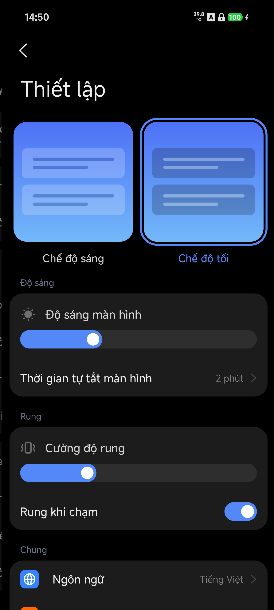
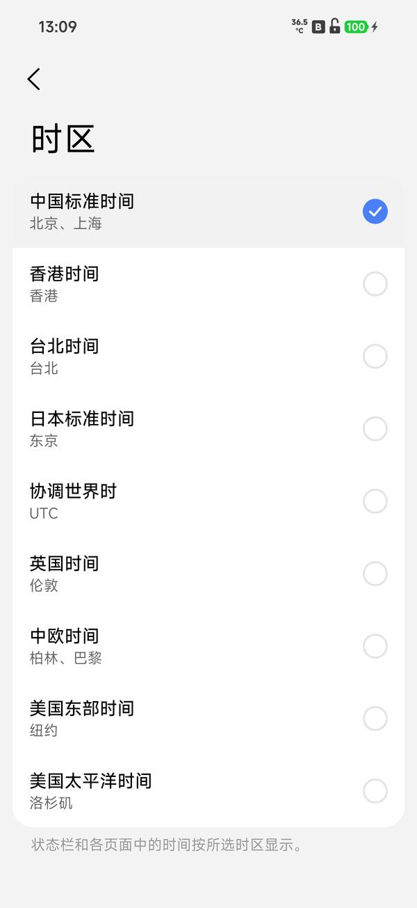
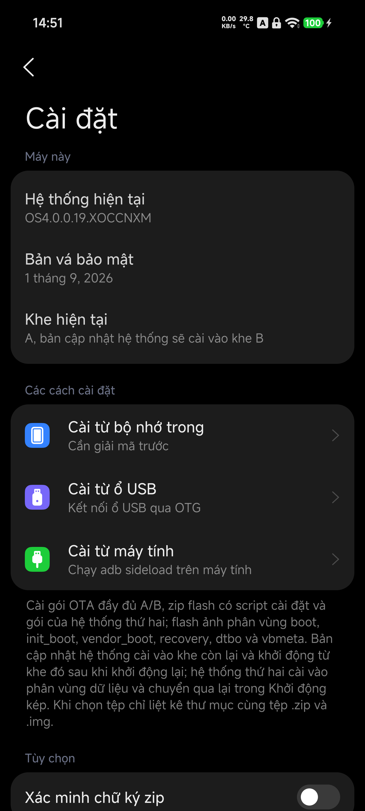
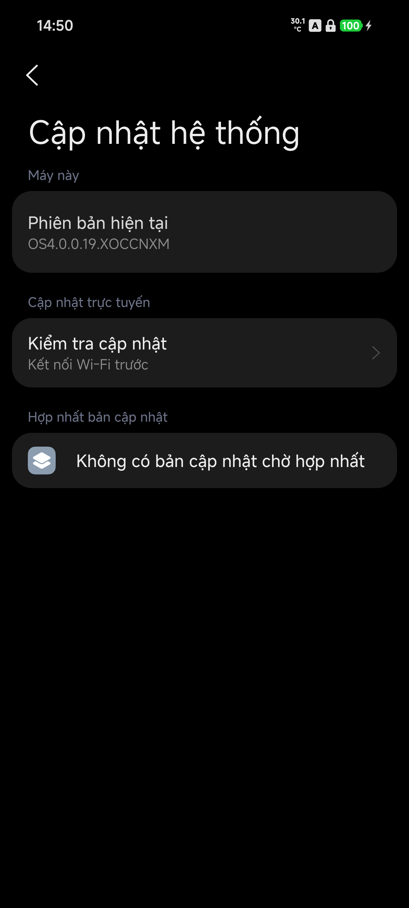
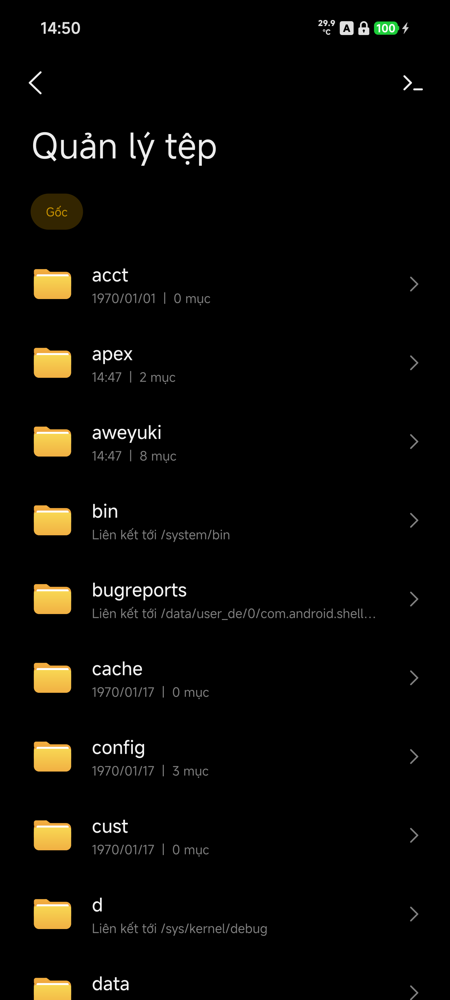
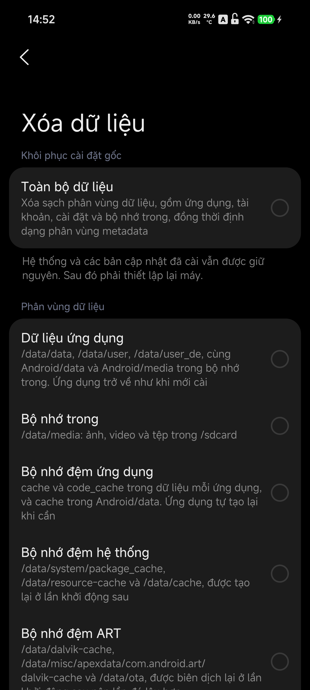
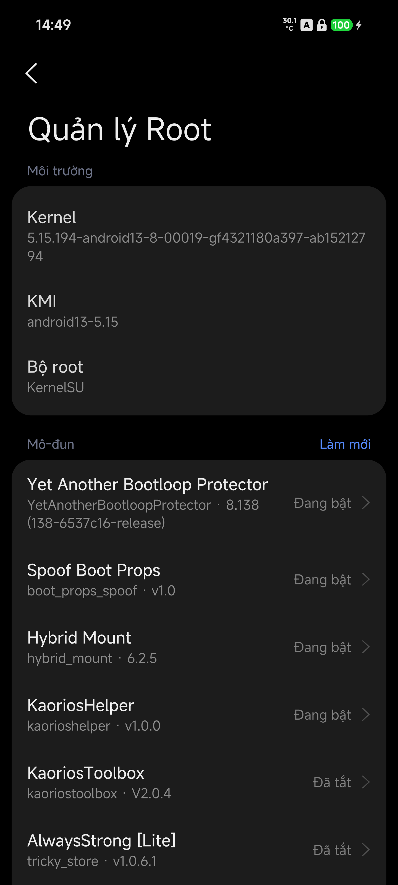
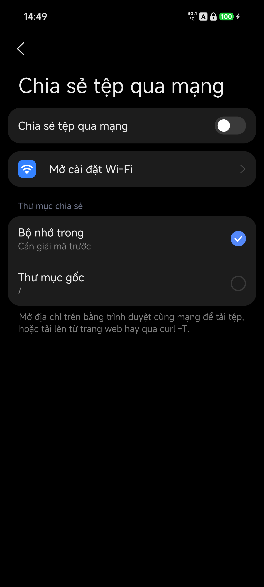
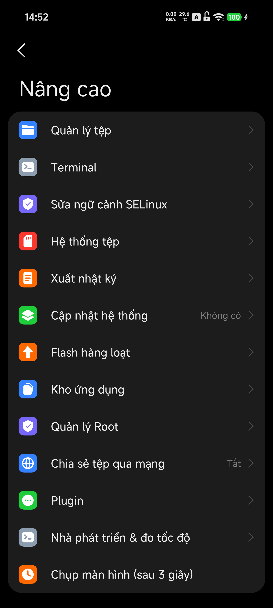

# Aweyuki Recovery

[English](README.md) | 简体中文 | [Tiếng Việt](README.vi.md)

Aweyuki Recovery 是使用 Rust 从零编写的 Android recovery。

<p align="center">
  
  
  
</p>

## 功能

### 双系统

<p align="center">
  
</p>

可在主系统（HyperOS 或第三方 ROM）旁安装并切换第二系统，切换过程由 `/metadata` 原子记录，仅改写 `boot` 与 `init_boot` 分区。第二系统的安装包格式和启动过程见下文的[双系统的工作方式](#双系统的工作方式)。

### 解密与恢复模式 PIN 锁

<p align="center">
  
</p>

支持使用系统的锁屏图案、PIN 或密码解密 `/data` 分区，并可为 Recovery 本身设置独立的恢复模式 PIN 锁。

### 安装、OTA Payload 检查与批量刷入

<p align="center">
  
  
</p>

- **安装来源与工具**：支持从内部存储、USB OTG 或 ADB Sideload 刷入 `.zip`、`.img`、`.efi` 及双系统安装包，支持 zip 签名校验。刷机脚本可使用 `7za`、`zstd`、流式 `unzip -p`、`avbctl` 和 `resetprop`。
- **OTA Payload 检查与 ARB 检测**：解析 `payload.bin` / OTA `.zip` 清单，执行防回滚（ARB）安全补丁与时间戳校验，并支持提取指定分区（`REPLACE`、`REPLACE_ZSTD`、`ZERO`、`DISCARD`）。
- **批量刷入与 EFISP**：支持带分区几何预校验的多镜像 `.img`/`.efi` 批量刷入，包括向非 A/B 的 `efisp` 分区直接刷入并校验 ARM64 `.efi` 镜像。

### 在线更新与 WLAN

<p align="center">
  
  
</p>

直接在 Recovery 中连接 2.4 GHz / 5 GHz WLAN，在线检查并安装系统更新（支持显示 A/B 合并状态）以及在线自更新 Aweyuki Recovery。

### 备份、恢复与应用保险库

<p align="center">
  
  
  
</p>

- **备份与恢复**：可将 `boot`、`system`、`data`、基带与 EFS 以及可选的 `efisp` 备份到内部存储或 USB OTG，支持压缩与校验。
- **应用保险库（App Vault）**：以 `.tar.lz4` 格式将单个用户应用备份和恢复至 `/sdcard/Aweyuki/app-vault`。

### 文件管理、挂载与终端

<p align="center">
  
  
  
</p>

- **文件管理**：浏览 `/` 目录，显示文件元信息、符号链接目标以及终端快捷入口。
- **挂载与 USB**：手动挂载/卸载动态分区（`system`、`vendor`、`product`、`odm`、`mi_ext`、`system_ext`、`system_dlkm`），并管理 USB MTP 与 ADB 连接。
- **终端**：内置 Root Shell，配备屏幕虚拟按键（`Esc`、`Tab`、`Ctrl` 与方向键）。

### 清除数据、SELinux 与文件系统修复

<p align="center">
  
  
  
</p>

每一项清除操作均明确列出清除范围。支持修复 `/data` 的 SELinux 上下文、检查并修复 `/data`（`f2fs`）文件系统，以及对 `efisp` 和 `frp` 分区执行逐字节校验的全零擦除。

### Root 管理

<p align="center">
  
</p>

自动解析内核版本与 KMI（如 `5.15.194` / `android13-5.15`），识别 Magisk、KernelSU 和 APatch 框架，并支持开关或标记卸载 `/data/adb/modules/*` 模块。

### 网络文件共享与远程投屏 (`/mirror`)

<p align="center">
  
</p>

通过 Wi-Fi 启动 HTTP/1.1 文件共享服务，支持电脑浏览器上传/下载或 `curl -T`，同时提供 `/mirror` 远程实时投屏、触控/按键控制以及一键保存 PNG 截图。

### 运行时插件与 AERA `.aerap` 应用

<p align="center">
  
</p>

支持运行带实时流式输出与中止功能的 `plugin.toml` 脚本插件，并支持隔离沙箱化的 AERA `.aerap` GUI 运行时插件，包括 **AERA Browser**（WPE WebKit 浏览器）和 **AERA Telegram**（TDLib 客户端）。

### 高级工具、开发者选项与无音量键截图

<p align="center">
  
  
</p>

- **高级工具中心**：集中提供搜索、日志（含近期刷写/擦除历史）、文件管理、终端、SELinux/文件系统修复、Root 管理、网络文件共享、插件和应用保险库。
- **开发者与存储基准测试**：查看和调整 `printk` 日志级别、SELinux 模式、USB/ADB 状态、CPU 调度器、内核 `cmdline`，并运行 64 MiB 顺序存储读写基准测试。
- **无音量键截图**：可通过高级菜单中的**延迟 3 秒截图**（截取前自动隐藏提示条）或在 `/mirror` 网页端一键保存 PNG 截图。

### 设置、关于本机与重启

<p align="center">
  
  
</p>

- **语言与主题**：浅色与深色模式；15 种语言（简体中文、繁體中文、English、Türkçe、Русский、Українська、Español、Português (Brasil)、Bahasa Indonesia、Tiếng Việt、Deutsch、Français、Italiano、Polski 和日本語）；支持含越南时区（`Asia/Ho_Chi_Minh`, UTC+7）在内的 IANA 时区。
- **关于本机**：查看 Aweyuki 版本、存储空间、处理器、内存、电池健康度与充电循环次数。
- **重启与槽位切换**：重启至系统、Recovery、Fastboot、Bootloader、EDL 或关机，切换 A/B 启动槽位，并在重启前执行 ABL EFISP 加载器回归检查。

## 支持的机型

| 机型 | 代号 | 测试的系统版本 |
| --- | --- | --- |
| 小米 17 Ultra | `nezha` | OS4.0.4.0.XPACNXM（Android 17） |
| 小米 13 Ultra | `ishtar` | OS3.0.308.0.WMACNXM（Android 16） |
| REDMI K60 Pro | `socrates` | OS4.0.0.24.XMKCNXM（Android 17） |
| 小米 13 Pro | `nuwa` | OS3.0.312.0.WMBCNXM（Android 16） |

### 🚧 施工中

这些机型的镜像按照各自的原厂固件构建，还没有在真机上试过。屏幕、触摸、WLAN 和振动已经配置好。解密 data 分区所需的程序由 Aweyuki 在手机上从已安装系统的 init 脚本和服务描述中读出，每个机型的读取结果都用原厂固件核对过，这些程序在这些机型上的运行情况还没有验证。

| 机型 | 代号 | 构建所用的系统版本 |
| --- | --- | --- |
| 🚧 小米 13 | `fuxi` | OS3.0.309.0.WMCCNXM（Android 16） |
| 🚧 小米 14 | `houji` | OS3.0.307.0.WNCCNXM（Android 16） |
| 🚧 小米 14 Pro | `shennong` | OS3.0.309.0.WNBCNXM（Android 16） |
| 🚧 小米 14 Ultra | `aurora` | OS3.0.308.0.WNACNXM（Android 16） |
| 🚧 小米 15 | `dada` | OS3.0.307.0.WOCCNXM（Android 16） |
| 🚧 小米 15 Pro | `haotian` | OS3.0.309.0.WOBCNXM（Android 16） |
| 🚧 小米 15 Ultra | `xuanyuan` | OS3.0.314.0.WOACNXM（Android 16） |
| 🚧 小米 17 | `pudding` | OS4.0.4.0.XPCCNXM（Android 17） |
| 🚧 小米 17 Pro | `pandora` | OS4.0.4.0.XBLCNXM（Android 17） |
| 🚧 小米 17 Pro Max | `popsicle` | OS4.0.4.0.XPBCNXM（Android 17） |
| 🚧 小米 17 Max | `byron` | OS3.0.310.0.WAFCNXM（Android 16） |
| 🚧 REDMI K80 | `zorn` | OS3.0.309.0.WOKCNXM（Android 16） |
| 🚧 REDMI K80 Pro | `miro` | OS3.0.305.0.WOMCNXM（Android 16） |
| 🚧 REDMI K90 | `annibale` | OS3.0.307.0.WPKCNXM（Android 16） |
| 🚧 REDMI K90 Pro Max | `myron` | OS4.0.4.0.XPMCNXM（Android 17） |
| 🚧 REDMI K90 Ultra | `warsaw` | OS3.0.309.0.WHPCNXM（Android 16） |
| 🚧 REDMI K100 Pro | `athens` | OS4.0.4.0.XPICNXM（Android 17） |
| 🚧 REDMI K100 Pro Max | `songyuan` | OS4.0.4.0.XGNCNXM（Android 17） |

### 社区适配机型

汇总自 `kirklin/skyward` 的各个社区 Fork（可点击来源仓库链接查看维护者与适配详情）。包含 `[stock]` 的机型会由 CI 自动构建；标注“本地打包”的机型可使用 `aweyuki-pack` 搭配本机原厂 `recovery.img` 或 `vendor_boot.img` 手动打包。

<!-- COMMUNITY-DEVICES-START -->
| 机型 | 代号 | 构建版本 | 来源仓库 |
| --- | --- | --- | --- |
| OnePlus ACE 6T | `OP6117L1` | 本地打包（无 `[stock]`） | [servant1228/skyward-plr110](https://github.com/servant1228/skyward-plr110) |
| OnePlus PLY110 (一加 Turbo 6V) | `OP64D3L1` | 本地打包（无 `[stock]`） | [TvTzzz/skyward-oneplus-turbo-6v](https://github.com/TvTzzz/skyward-oneplus-turbo-6v) |
| OnePlus Ace 6 | `PLQ110` | 本地打包（无 `[stock]`） | [liuyimeng1024-ui/skyward-for-oneplusace6](https://github.com/liuyimeng1024-ui/skyward-for-oneplusace6) |
| realme RMX3551 | `RE5465` | 本地打包（无 `[stock]`） | [partofpai/skyward-oplus-sm8475](https://github.com/partofpai/skyward-oplus-sm8475) |
| realme 真我Neo7 | `RMX5060` | 本地打包（无 `[stock]`） | [aaabbk/Realme_neo7_skyward](https://github.com/aaabbk/Realme_neo7_skyward) |
| OPPO A57 | `a57` | `lineage-22.1-20260715` | [Max1937/skyward-a57](https://github.com/Max1937/skyward-a57) |
| Redmi K40 | `alioth` | `OS1.0.10.0.TKHCNXM` | [fuxilover/skyward](https://github.com/fuxilover/skyward) |
| Redmi Note 14 Pro+ 5G | `amethyst` | `OS3.0.306.0.WOPCNXM` | [7-Ice/skyward](https://github.com/7-Ice/skyward) |
| Redmi K30S Ultra | `apollo` | 本地打包（无 `[stock]`） | [kafuzhi/skyward](https://github.com/kafuzhi/skyward) |
| Samsung Galaxy Z Flip4 5G | `b4q` | 本地打包（无 `[stock]`） | [yanzihan/Skyward-Galaxy](https://github.com/yanzihan/Skyward-Galaxy) |
| Xiaomi MIX Fold 3 | `babylon` | `OS3.0.304.0.WMVCNXM` | [zfgysyuef/skyward](https://github.com/zfgysyuef/skyward) |
| Xiaomi Redmi Note 8 Pro | `begonia` | 本地打包（无 `[stock]`） | [pacman-Sy/skyward](https://github.com/pacman-Sy/skyward) |
| Xiaomi MIX Flip 2 | `bixi` | `OS4.0.0.11.XOHCNXM` | [XQAB/skyward](https://github.com/XQAB/skyward) |
| motorola ThinkPhone by motorola | `bronco` | 本地打包（无 `[stock]`） | [iljasrb/skyward](https://github.com/iljasrb/skyward) |
| Redmi Note 9 5G | `cannon` | 本地打包（无 `[stock]`） | [limitbeer0/skyward-cannon](https://github.com/limitbeer0/skyward-cannon) |
| Xiaomi Mi 10 Ultra | `cas` | 本地打包（无 `[stock]`） | [kafuzhi/skyward](https://github.com/kafuzhi/skyward) |
| Xiaomi Mi MIX 2 | `chiron` | `V12.0.1.0.PDECNXM` | [6ewjso6-gif/skyward](https://github.com/6ewjso6-gif/skyward) |
| REDMI Note 10 Pro | `chopin` | `V14.0.8.0.TKPCNXM` | [Hwhmi/skyward](https://github.com/Hwhmi/skyward) |
| Xiaomi Mi 10 Pro | `cmi` | 本地打包（无 `[stock]`） | [kafuzhi/skyward](https://github.com/kafuzhi/skyward) |
| OnePlus Ace 3 Pro | `corvette` | 本地打包（无 `[stock]`） | [Hotsteel2901/skyward-OPA3P](https://github.com/Hotsteel2901/skyward-OPA3P) |
| Xiaomi Mi 9 Pro 5G | `crux` | 本地打包（无 `[stock]`） | [tao88vip/skyward](https://github.com/tao88vip/skyward) |
| Xiaomi MI 8 | `dipper` | 本地打包（无 `[stock]`） | [yuan-shiguang/skyward](https://github.com/yuan-shiguang/skyward) |
| Redmi K50 Ultra | `diting` | `OS3.0.3.0.VLFCNXM` | [East888666/skyward-xiaomi-legacy](https://github.com/East888666/skyward-xiaomi-legacy) |
| realme GT6 (RMX3800) | `divo` | 本地打包（无 `[stock]`） | [ChuiShui233/realme-pineapple-skyward](https://github.com/ChuiShui233/realme-pineapple-skyward) |
| OnePlus 13 | `dodge` | 本地打包（无 `[stock]`） | [Hdy08/skyward](https://github.com/Hdy08/skyward) |
| Xiaomi Pad 5 Pro 5G | `enuma` | `OS1.0.3.0.TKZCNXM` | [kayn0922/skyward](https://github.com/kayn0922/skyward) |
| OnePlus Pad 2 Pro | `erhai` | 本地打包（无 `[stock]`） | [Goldzxcbug/skyward](https://github.com/Goldzxcbug/skyward) |
| Redmi Note 11 5G | `evergo` | 本地打包（无 `[stock]`） | [SkyShadowHero/skyward_for_evergo](https://github.com/SkyShadowHero/skyward_for_evergo) |
| realme GT7 | `gt7` | 本地打包（无 `[stock]`） | [ReikoYuzuka/skyward](https://github.com/ReikoYuzuka/skyward) |
| realme GT8 | `gt8` | 本地打包（无 `[stock]`） | [ReikoYuzuka/skyward](https://github.com/ReikoYuzuka/skyward) |
| OnePlus 7 | `guacamoleb` | 本地打包（无 `[stock]`） | [imqinyu/skyward_guacamoleb](https://github.com/imqinyu/skyward_guacamoleb) |
| Redmi K40 Pro | `haydn` | 本地打包（无 `[stock]`） | [qaz6750/skyward](https://github.com/qaz6750/skyward) |
| OnePlus Ace 5 Pro | `hummer` | `v13.1` | [venti1112/skyward-hummer](https://github.com/venti1112/skyward-hummer) |
| Xiaomi Mi Note 3 | `jason-los23` | 本地打包（无 `[stock]`） | [East888666/skyward-xiaomi-legacy](https://github.com/East888666/skyward-xiaomi-legacy) |
| Xiaomi Mi Note 3 | `jason-miui12` | 本地打包（无 `[stock]`） | [East888666/skyward-xiaomi-legacy](https://github.com/East888666/skyward-xiaomi-legacy) |
| Xiaomi Mi Note 3 | `jason` | 本地打包（无 `[stock]`） | [East888666/skyward-xiaomi-legacy](https://github.com/East888666/skyward-xiaomi-legacy) |
| OnePlus 8T | `kebab` | 本地打包（无 `[stock]`） | [toraidl/skyward](https://github.com/toraidl/skyward) |
| Xiaomi Redmi Note 7 | `lavender` | 本地打包（无 `[stock]`） | [aLpHa-Git-69/skyward](https://github.com/aLpHa-Git-69/skyward) |
| OnePlus 9R | `lemonades` | 本地打包（无 `[stock]`） | [lululuhu/skyward](https://github.com/lululuhu/skyward) |
| Xiaomi Pad 6 Pro | `liuqin-nomounts` | `OS3.0.7.0.VMYCNXM` | [qasg/skyward-Xiaomio-Pad-6-Pro](https://github.com/qasg/skyward-Xiaomio-Pad-6-Pro) |
| Xiaomi Pad 6 Pro | `liuqin` | `OS3.0.7.0.VMYCNXM` | [qasg/skyward-Xiaomio-Pad-6-Pro](https://github.com/qasg/skyward-Xiaomio-Pad-6-Pro) |
| Redmi K30 Pro | `lmi` | 本地打包（无 `[stock]`） | [kafuzhi/skyward](https://github.com/kafuzhi/skyward) |
| Xiaomi Civi 5 Pro | `luming` | `OS4.0.2.0.XOICNXM` | [justistab3-bot/skyward](https://github.com/justistab3-bot/skyward) |
| Meizu 20 | `m2381` | 本地打包（无 `[stock]`） | [un6666cn/skyward](https://github.com/un6666cn/skyward) |
| MEIZU 20 Pro | `m2391` | 本地打包（无 `[stock]`） | [baizhi958216/skyward](https://github.com/baizhi958216/skyward) |
| REDMI K70 Pro | `manet` | `OS3.0.307.0.WNMCNXM` | [Kinaxie/skyward](https://github.com/Kinaxie/skyward) |
| Redmi Note 12 Turbo | `marble` | `OS3.0.5.0.VMRCNXM` | [lingdiansr/skyward-marble](https://github.com/lingdiansr/skyward-marble) |
| Redmi Note 9 (Global) | `merlinx` | 本地打包（无 `[stock]`） | [Dracen-W/skyward-merlinx](https://github.com/Dracen-W/skyward-merlinx) |
| Xiaomi Mi-Thorium 4.19 | `mi8937_4_19` | 本地打包（无 `[stock]`） | [aLpHa-Git-69/skyward](https://github.com/aLpHa-Git-69/skyward) |
| Redmi K60 | `mondrian` | `OS3.0.8.0.VMNCNXM` | [Kinaxie/skyward](https://github.com/Kinaxie/skyward) |
| Xiaomi Pad 7 Pro | `muyu` | `OS4.0.3.0.XOYCNXM` | [Kinaxie/skyward](https://github.com/Kinaxie/skyward) |
| Xiaomi Pad 5 | `nabu` | 本地打包（无 `[stock]`） | [NekoMymaomao/skyward](https://github.com/NekoMymaomao/skyward) |
| Nubia Z70 Ultra | `nx733j` | 本地打包（无 `[stock]`） | [Hdy08/skyward](https://github.com/Hdy08/skyward) |
| nubia REDMAGIC 10 Pro | `nx789j` | 本地打包（无 `[stock]`） | [GIT-LINCC/skyward-nx789j](https://github.com/GIT-LINCC/skyward-nx789j) |
| REDMI Turbo 4 Pro | `onyx` | `OS4.0.4.0.XOLCNXM` | [Kinaxie/skyward](https://github.com/Kinaxie/skyward) |
| OPPO Find X3 | `op4e5d` | 本地打包（无 `[stock]`） | [toraidl/skyward](https://github.com/toraidl/skyward) |
| OnePlus Ace 6 | `op6113l1` | 本地打包（无 `[stock]`） | [lengyue632-commits/skyward](https://github.com/lengyue632-commits/skyward) |
| OnePlus Ace 5 | `ossi` | 本地打包（无 `[stock]`） | [Ral-sei/skyward-for-oneplusace5](https://github.com/Ral-sei/skyward-for-oneplusace5) |
| EEBBK X3/X5/X6A/A6/A7 | `p21h170` | 本地打包（无 `[stock]`） | [weikaizhi4/skyward](https://github.com/weikaizhi4/skyward) |
| EEBBK A2/X2/X2 Pro | `p22h190` | 本地打包（无 `[stock]`） | [weikaizhi4/skyward](https://github.com/weikaizhi4/skyward) |
| Samsung Galaxy S21 Ultra 5G | `p3q` | 本地打包（无 `[stock]`） | [yanzihan/Skyward-Galaxy](https://github.com/yanzihan/Skyward-Galaxy) |
| OPPO A9x | `pcem00` | 本地打包（无 `[stock]`） | [Winkmoon/skyward](https://github.com/Winkmoon/skyward) |
| OPPO A11x | `pchm30` | 本地打包（无 `[stock]`） | [hhsbjbsj/skyward](https://github.com/hhsbjbsj/skyward) |
| Xiaomi Redmi Turbo 3 | `peridot` | `OS3.0.305.0.WNPCNXM` | [hoshino114/skyward](https://github.com/hoshino114/skyward) |
| Xiaomi Pad 8 Pro | `piano` | `OS4.0.6.0.XPYCNXM` | [Kinaxie/skyward](https://github.com/Kinaxie/skyward) |
| OnePlus 15 | `plk110` | 本地打包（无 `[stock]`） | [liyongshun114514/skyward](https://github.com/liyongshun114514/skyward) |
| Xiaomi Mi MIX 2S | `polaris` | 本地打包（无 `[stock]`） | [6ewjso6-gif/skyward](https://github.com/6ewjso6-gif/skyward) |
| Xiaomi 12X | `psyche` | `OS3.0.309.0.WMCCNXM` | [abedmatar7/skyward](https://github.com/abedmatar7/skyward) |
| samsung Galaxy S20 FE 5G | `r8q` | 本地打包（无 `[stock]`） | [iljasrb/skyward](https://github.com/iljasrb/skyward) |
| OPPO R9s | `r9s` | 本地打包（无 `[stock]`） | [Max1937/skyward-a57](https://github.com/Max1937/skyward-a57) |
| Redmi K20 Pro | `raphael` | 本地打包（无 `[stock]`） | [6ewjso6-gif/skyward](https://github.com/6ewjso6-gif/skyward) |
| Xiaomi Mi 11 Lite 5G | `renoir` | 本地打包（无 `[stock]`） | [wannqn/skyward](https://github.com/wannqn/skyward) |
| realme RMX3888 | `rmx3888` | 本地打包（无 `[stock]`） | [maozi-114/skyward-rmx3888](https://github.com/maozi-114/skyward-rmx3888) |
| realme GT7 Pro | `rmx5010` | 本地打包（无 `[stock]`） | [KevinXu07/skyward](https://github.com/KevinXu07/skyward) |
| Xiaomi MIX Flip | `ruyi` | `OS3.0.305.0.WNIMIXM` | [Kinaxie/skyward](https://github.com/Kinaxie/skyward) |
| Xiaomi Mi 6 | `sagit` | 本地打包（无 `[stock]`） | [KextNor/skyward](https://github.com/KextNor/skyward) |
| Xiaomi Pad 6S Pro 12.4 | `sheng` | `OS3.0.303.0.WNXCNXM` | [Kinaxie/skyward](https://github.com/Kinaxie/skyward) |
| Redmi K60 Pro | `socrates-decrypt` | `OS3.0.304.0.WMKCNXM` | [dhhdheh/skyward](https://github.com/dhhdheh/skyward) |
| Nothing Phone (1) | `spacewar` | 本地打包（无 `[stock]`） | [BruxinCore/Skyward-spacewar](https://github.com/BruxinCore/Skyward-spacewar) |
| Xiaomi 11 Ultra | `star` | 本地打包（无 `[stock]`） | [LiAA-CN/skyward-for-Mi11P-U](https://github.com/LiAA-CN/skyward-for-Mi11P-U) |
| Redmi Note 12 5G | `sunstone-2` | 本地打包（无 `[stock]`） | [hss2671/skyward](https://github.com/hss2671/skyward) |
| Redmi Note 12R Pro | `sunstone` | 本地打包（无 `[stock]`） | [hss2671/skyward](https://github.com/hss2671/skyward) |
| Lenovo Xiaoxin Pad Pro GT | `tb710fu` | 本地打包（无 `[stock]`） | [WASDDestroy/skyward](https://github.com/WASDDestroy/skyward) |
| Xiaomi Mi 10S | `thyme` | 本地打包（无 `[stock]`） | [Flicker-Android-Devices/skyward-mikona](https://github.com/Flicker-Android-Devices/skyward-mikona) |
| REDMI K Pad | `turner` | 本地打包（无 `[stock]`） | [xiaozhou0307/skyward](https://github.com/xiaozhou0307/skyward) |
| Xiaomi 10 | `umi` | `OS1.0.5.0.TJBCNXM` | [Alittlejelly/skyward-for-MI10](https://github.com/Alittlejelly/skyward-for-MI10) |
| Xiaomi 12S Pro | `unicorn` | `OS3.0.4.0.VLECNXM` | [Kinaxie/skyward](https://github.com/Kinaxie/skyward) |
| Xiaomi 11 | `venus` | 本地打包（无 `[stock]`） | [cvbyisme/skyward-venus-archive](https://github.com/cvbyisme/skyward-venus-archive) |
| Redmi K70 | `vermeer` | `OS3.0.307.0.WNKCNXM` | [luoxunyong/skyward-by-Redmi-K70](https://github.com/luoxunyong/skyward-by-Redmi-K70) |
| Xiaomi Pad 7S Pro 12.5 | `violin` | `OS4.0.5.0.XOTCNXM` | [shu-chong/skyward-for-violin](https://github.com/shu-chong/skyward-for-violin) |
| REDMI K90 Ultra | `warsaw-4.0.4.0` | `OS4.0.4.0.XHPCNXM` | [wjljh/skyward-for-warsaw](https://github.com/wjljh/skyward-for-warsaw) |
| REDMI K90 Ultra | `warsaw-4.0.8.0.nfchal` | `OS4.0.8.0.XHPCNXM` | [wjljh/skyward-for-warsaw](https://github.com/wjljh/skyward-for-warsaw) |
| REDMI K90 Ultra | `warsaw-4.0.8.0` | `OS4.0.8.0.XHPCNXM` | [wjljh/skyward-for-warsaw](https://github.com/wjljh/skyward-for-warsaw) |
| Xiaomi MI 6X | `wayne` | 本地打包（无 `[stock]`） | [East888666/skyward-xiaomi-legacy](https://github.com/East888666/skyward-xiaomi-legacy) |
| Redmi Note 11T Pro | `xaga` | `OS1.0.3.0.ULOCNXM` | [BkaNeko/xaga-skyward](https://github.com/BkaNeko/xaga-skyward) |
| Samsung Galaxy S20+ 5G | `y2q` | 本地打包（无 `[stock]`） | [yanzihan/Skyward-Galaxy](https://github.com/yanzihan/Skyward-Galaxy) |
| Xiaomi Pad 6 Max 14 | `yudi` | `OS3.0.6.0.VMHCNXM` | [HuberyBrook/skyward](https://github.com/HuberyBrook/skyward) |
| Xiaomi Pad 8 | `yupei` | `OS4.0.12.0.XPZCNXM` | [d2su8/skyward](https://github.com/d2su8/skyward) |
| Xiaomi MIX Fold 2 | `zizhan` | 本地打包（无 `[stock]`） | [Hdy08/skyward](https://github.com/Hdy08/skyward) |
<!-- COMMUNITY-DEVICES-END -->

### 添加新机型

GitHub Actions 会自动发现并构建 `devices/*.toml` 中所有配置了 `[stock]` 的机型（已支持 `recovery`、`vendor_boot`、Linux 4.19 / HIDL `keymaster@4.0` 解密、预设波形振动以及无 `init_boot` 的双系统）。要为以上列表之外的机型添加支持：

- 新建 `devices/<codename>.toml`（填写屏幕、触摸、内核模块、分区、WLAN、振动、备份与日志路径，以及 `[stock]` 官方完整更新包信息）。
- 使用 `aweyuki-pack described` 将官方包中的 init/VINTF 描述提取到 `crates/aweyuki-programs/tests/described/<codename>`。
- 在 `crates/aweyuki-config/src/lib.rs` 中登记 `[stock].version` 测试项并运行 `cargo test --workspace`。
- 在 README 支持列表中先加入 `🚧 施工中` 表格，在真机上验证完整后再移入主支持列表。

详细步骤请查看[添加新机型指南（英文）](docs/adding-devices.md)或[越南语版本](docs/adding-devices.vi.md)。

## 安装 Aweyuki Recovery

Aweyuki 需要已解锁的 bootloader。从 [Releases](https://github.com/AweYuki/aweyuki_recovery/releases) 下载对应机型的 zip，每个文件都标有机型和代号，例如 Xiaomi 17 Ultra (nezha)。使用 `SHA256SUMS` 核对并解压之后，在手机处于 fastboot 模式的时候，把其中的镜像刷入当前运行槽位的 recovery 分区：

```sh
unzip aweyuki-v0.5.1-nezha-OS4.0.4.0.XPACNXM.zip
fastboot flash recovery aweyuki-v0.5.1-nezha-OS4.0.4.0.XPACNXM.img
fastboot reboot recovery
```

之后连接 WLAN，就可以在“设置”的“Aweyuki 更新”页面更新到最新版本，也可以在 Aweyuki 自己的“安装”页面安装解压出来的新版镜像。打开 **自动重新刷入 Aweyuki** 之后，系统更新或者刷机包覆盖 recovery 分区的时候，Aweyuki 会重新刷回这些分区。

Aweyuki 中的 adb 是 root shell，手机上无需授权：手机处于 recovery 的时候，任何人拿到手机和数据线都能访问其中的存储。

## 双系统的工作方式

Aweyuki 可以在手机自身分区中的系统旁边安装第二系统，主系统是 HyperOS 或者第三方 ROM 都可以，并在首页的“双系统”中切换。第二系统的根文件系统是 data 分区中的一个文件，文件系统不能移动或删除它，Aweyuki 直接通过分区读写其中的内容；两个系统的启动镜像保存在另一个这样的文件中。切换系统只改写下次启动槽位的 boot 和 init_boot 分区，每一步都先记录在 /metadata 中，切换过程中断电的话，Aweyuki 下次启动时会完成这次切换。vendor_boot、dtbo、recovery、vbmeta、固件和 super 都保持不变，第二系统使用主系统的 vendor_boot 和 dtbo 启动。

其他操作写入启动分区之前，Aweyuki 会先把主系统的启动镜像写回：安装、切换启动槽位、fastboot、恢复出厂设置，以及备份或恢复启动分区。系统更新尚未合并的时候，暂不切换到第二系统；备份 data 分区的时候不包含第二系统。

第二系统的安装包是 zip 文件，和其他安装包一样在“安装”页面安装：

| 文件 | 内容 |
| --- | --- |
| `system.toml` | `id`、`name`、`version` 和 `filesystem`；`init` 是根文件系统中第一个运行的程序，默认为 `/sbin/init`；`minimum` 是根文件系统至少需要的空间，单位为字节 |
| `boot.img` | bootloader 启动的内核 |
| `rootfs.img` | 根文件系统的镜像，格式为 `filesystem` 指定的文件系统 |
| `init_boot.img` | 只有自带第一阶段 ramdisk 的系统需要 |

没有自带 init_boot 镜像的系统，从 Aweyuki 生成的 init_boot 镜像启动。其中的程序按照主系统第一阶段的方式加载第一阶段的内核模块，包括模块之间的软依赖和内核命令行中给模块的参数，然后在 data 分区中找到根文件系统，挂载之后运行其中的 `init`。启动过程中出现任何错误，这个程序都会进入 Aweyuki，和主系统启动失败时进入 recovery 一样：它在 misc 中留下原因，把当前槽位 recovery 分区中的 ramdisk 按照 bootloader 启动 recovery 时内核解包的方式解包到自己的 ramdisk 上，然后交给 Aweyuki 的第一个程序运行，所以无论 bootloader 怎样处理重启，都能进入 Aweyuki。Aweyuki 显示原因；用户在“双系统”中切换之前，下次启动的仍是第二系统。启动长时间没有进展时，这个程序改为重启到 recovery；交给第二系统之前手机重启的话，下次启动时它会在 misc 中看到同样的请求，先进入 Aweyuki。两种方式都无法进入 Aweyuki 时，手机停留在出错的地方，不会反复启动同一个系统。自带第一阶段 ramdisk 的系统可以运行 Aweyuki 放在 `/aweyuki/map` 的程序，它把根文件系统映射为块设备，并输出设备节点的路径。每次切换到第二系统，Aweyuki 都用自己带的程序写入第二系统的 init_boot 镜像，所以更新 Aweyuki 以后，第二系统也用新的程序启动。

正在运行的系统也可以请求切换：在 misc 中写入 `boot-recovery` 和 `--switch_system=installed`，或者 `--switch_system=` 加上第二系统的 `id`，然后重启到 recovery。bootloader 仍然启动这个槽位的话（小米 13 Ultra 连着 USB 线时可能这样），Aweyuki 的程序会在下次启动时在 misc 中看到这个请求，先进入 Aweyuki。

## 构建

Aweyuki 使用 `rust-toolchain.toml` 指定版本的 Rust 和它的 `aarch64-linux-android` 目标、Android NDK r29 和 [cargo-ndk](https://github.com/bbqsrc/cargo-ndk) 构建。recovery 服务针对手机构建，打包工具针对电脑构建：

```sh
cargo ndk -t arm64-v8a --platform 30 build --release -p aweyuki
cargo build --release -p aweyuki-pack
```

第二系统启动时运行的第一个程序在任何动态库可用之前运行，因此构建为静态程序：

```sh
RUSTFLAGS="-C target-feature=+crt-static" cargo ndk -t arm64-v8a --platform 30 build --release -p aweyuki-system-init --target-dir target/system-init
```

打包工具从小米服务器上这个版本的完整更新包中取出原厂 recovery 分区，只读取这个分区所在的部分，并且按照设备配置文件核对 SHA-256：

```sh
target/release/aweyuki-pack stock --config devices/nezha.toml --out target/stock/nezha/recovery.img
```

然后在它的基础上构建镜像：

```sh
target/release/aweyuki-pack recovery \
  --stock target/stock/nezha/recovery.img \
  --binary target/aarch64-linux-android/release/aweyuki \
  --system-init target/system-init/aarch64-linux-android/release/system-init \
  --config devices/nezha.toml \
  --font resources/fonts/MiSansVF.ttf \
  --mono resources/fonts/KirkMono-Regular.ttf \
  --mono-license resources/fonts/KirkMono-OFL.txt \
  --out target/aweyuki-nezha.img
```

测试和代码检查在电脑上运行；只在手机上运行的代码按照手机目标检查：

```sh
cargo test --workspace
cargo clippy --workspace --all-targets -- -D warnings
cargo ndk -t arm64-v8a --platform 30 clippy --workspace --all-targets -- -D warnings
```

名称以 `on_the_phone` 开头的测试会创建文件系统、挂载分区、设置加密密钥，这些操作只有手机能够完成。把一台已经进入 Aweyuki、数据分区已经打开的手机通过 adb 连接到电脑，`cargo ndk` 会把每个测试程序推送到手机上运行，测试逐个执行：

```sh
cargo ndk -t arm64-v8a --platform 30 test -p aweyuki -p aweyuki-block -p aweyuki-files -p aweyuki-mtp on_the_phone -- --test-threads=1
```

`aweyuki-preview` 无需手机，在电脑上把页面绘制成 PNG 文件：每个页面完整绘制成长截图的样子，覆盖它可能处于的各种状态，另外还有触摸和动画过程中某些时刻的屏幕。`--lang` 按照地区代码选择语言，例如 `en` 或者 `zh-TW`：

```sh
cargo run --release -p aweyuki-preview -- target/preview --lang en
```

### 翻译

每种语言的文字是 `crates/aweyuki-ui/locales` 里的一个文件，以地区代码命名，例如 `tr.toml`、`pt-BR.toml`。`en.toml` 是参照文件，每条文字上方的注释说明它显示在哪里。构建时会读取全部文件，缺少某条文字，或者花括号里的名称和英文不一致，构建就会停止。

修正翻译时，直接修改对应语言文件里的文字。用 `aweyuki-preview --lang` 把页面按这种语言绘制出来检查效果：每绘制完一个页面，它会列出这个页面上显示不下的文字：`cut short in` 是以省略号结尾的文字，`set at 80% in` 是为了放进按键、按钮或滑动条而缩小了字号的文字，`past the edge in` 是超出屏幕的文字，`overlap in` 是互相重叠的两段文字。

## 致谢

- [Skyward](https://github.com/kirklin/skyward)（Kirk Lin）— 原始 Rust Recovery 架构与界面基础。
- [AERA Recovery](https://github.com/AERA-Recovery) — EFISP、Root Manager、网络文件共享与运行时插件的设计参考。

## 许可证

[GPL-3.0-or-later](LICENSE)
